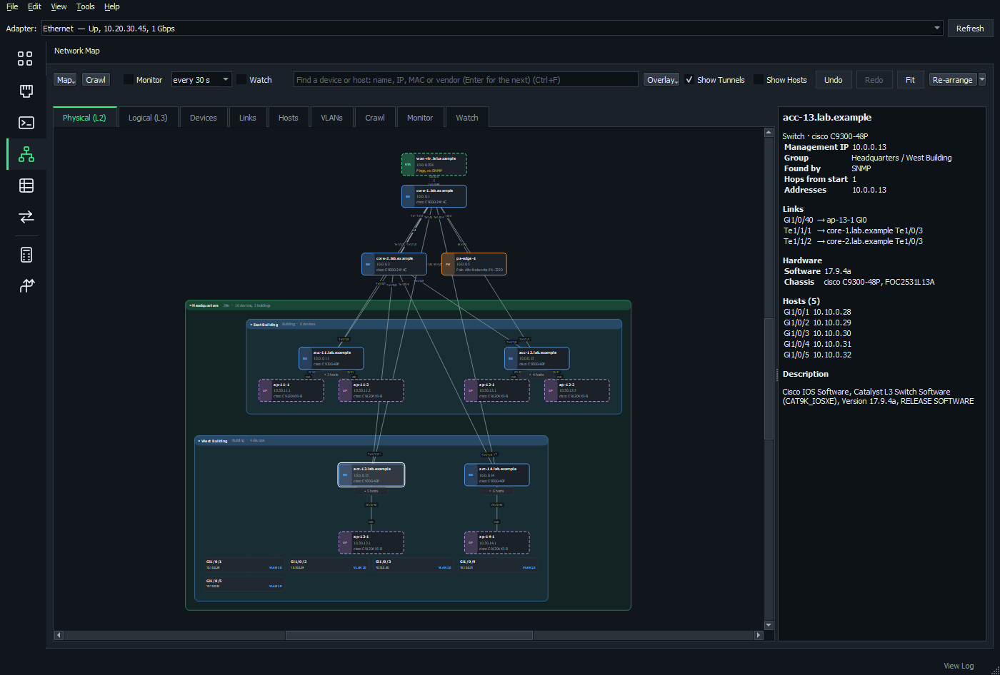

# NOMAD

**Network Operations, Monitoring And Diagnostics**

A single Windows application to configure local network settings, troubleshoot networks, manage devices, and visualize network topologies, while also including IPAM and asset management.



- **Works offline.** Tests only talk to the hosts you give them, and the MAC vendor list is built in.
- **One exe, nothing to install.** Run it from anywhere.
- **Safe changes.** New IP settings revert unless you confirm within 15 seconds. ACL and VPN changes go in with a revert timer.
- **Made for teams.** Share IP addresses, VLANs, assets and maps with your *tribe* through a server, and keep working when it can't be reached.

*Formerly NIC Manager, with the RADAR subnet sweep and the Latenct latency monitor built in.*

**Jump to:** [Quick start](#quick-start) · [What's in it](#whats-in-it) · [Guides](#guides) · [What it works with](#what-it-works-with) · [Good to know](#good-to-know) · [Build from source](#build-from-source)

## Quick start

### 1. Get NOMAD

1. Download the latest `NOMAD-<version>.exe` from [Releases](https://github.com/nousernamesavailabel/NOMAD/releases).
2. Run it. There's nothing to install.

Windows may warn about an app it doesn't recognize, because the exe isn't code-signed. Choose **More info** > **Run anyway**.

### 2. Find your way around

1. Pick your **adapter** at the top of the window. Many pages work with it.
2. Press **Ctrl+K** and type what you want, such as "ping" or "file transfer", to open a tool.
3. Right-click a tool to pin it to the **favorites rail** on the left.

NOMAD starts without administrator rights, so viewing and testing work straight away. When a change needs them, it offers to restart as administrator.

To simplify operations, check the "Always start as administrator" box at the top of the screen.

Press **F1** at any time for the keyboard guide.

### 3. Map your network

For automatic device discovery, read-only SNMP is required on your switches. [SNMP Config](docs/snmp-config.md) can build and send that configuration.

1. Open **Network Map**.
2. Enter a core switch, or click **Adapter's Gateway**.
3. Click **SNMP Credentials...** and add your community strings or SNMPv3 users.
4. Click **Start**.

The map draws itself as devices are found. Double-click a switch to see the hosts on its ports, and right-click a device for SSH, ping and more.

Manually adding devices that do not support SNMP is also supported. Right-click the map, **Add Device Here...**

### 4. Open a terminal session

1. Open **Terminal**.
2. Type into the **Quick connect** box, such as `admin@10.0.0.1`, `telnet 10.0.0.5` or `COM3:115200`, and press Enter.
3. Press **Ctrl+N** to save a session in a folder for next time.

#### Tired of typing the same login? 

1. Set a master password to encrypt your saved creds: **Tools** > **Saved Password Protection...** > **Set Master Password...**
2. Save your credentials: **Tools** > **Saved Credentials...**
3. You can now select these from a dropdown when you create terminal/SCP sessions. 

### 5. Track your addresses

1. Open **IP Addresses**.
2. Click **Network** > **New Network...**, or **Import Locally (Not Shared)...** if you have an addressing workbook.
3. Click **Add Subnet...** and enter a subnet.
4. Select the subnet and click **Use Next Free...** to record an address.

### 6. Share with your tribe

The tribe is everyone sharing one IPAM server. You need one always-on Windows machine for the server.

**On the server:**

1. Run NOMAD as administrator.
2. Open **Tools** > **Tribe Management...** and click **Install Service**.
3. Click **Save Tribe Key File**. Anyone with this file can change the tribe's data, so share it carefully.

**On each laptop:**

1. Open **IP Addresses**.
2. Click **Tribe** > **Connect with Tribe Key File...** and pick the key file.

Each laptop keeps its own copy of the data, so lookups and most changes work offline.

#### Share your IP addresses

Tribe networks are created on the server. Run NOMAD as administrator on the server and use **Network** > **New Network...** or **Import to Tribe Server...** on the **IP Addresses** page. Every connected laptop gets the new network.

A network created on a laptop stays on that laptop until you share it. See [Share a Local network](docs/ipam-and-tribe.md#share-a-local-network).

#### Share your map

1. Open the map on the **Network Map** page.
2. Click **Map** > **Tribe** > **Share This Map with the Tribe...** and give the map a name.
3. Under **IPAM network**, select the tribe network the map belongs to. If its network is still on your laptop, select that network to share it with the tribe as well.
4. Click **OK**. If you are sharing a network too, NOMAD asks you to confirm, because this can't be undone from your laptop.

Everyone in the tribe can now open the map from **Map** > **Tribe**. Its SNMP credentials are shared with it, and changes reach everyone within seconds.

#### How the map and IPAM work together

Sharing a map only shares its IPAM data if you choose to in step 3. That step is also what connects the two. Once connected, the map shows which hosts are missing from IPAM, **Record in IPAM...** adds them, and the **On Map** column on the **IP Addresses** page shows where each address is on the map.

For more, see [Maps and IPAM together](docs/ipam-and-tribe.md#maps-and-ipam-together).

## What's in it

For more on each page, see [All pages](docs/pages.md).

### This Computer

| Page | What it does |
| --- | --- |
| **Interfaces** | Adapter status; DHCP or static IP, DNS, MTU; saved profiles |
| **Routing Table** | View, filter, add and edit routes |
| **ARP** | Which MAC answers for each IP, with spoofing warnings |
| **Connections** | Every connection and the program that owns it |
| **Network Reset** | Flush DNS, renew DHCP, reset Winsock and TCP/IP |

### Connect & Transfer

| Page | What it does |
| --- | --- |
| **Terminal** | SSH, Telnet, serial and raw TCP in tabs and tiles |
| **SCP** | A WinSCP-style file manager |
| **RDP** | Saved Remote Desktop sessions |
| **TFTP** | A server and client for firmware and configs |
| **Wake-on-LAN** | Wake a computer by its MAC |

### Discover

| Page | What it does |
| --- | --- |
| **Sweep** | Find every host on a subnet |
| **Switch Port** | Which switch, port and VLAN you're plugged into |
| **MAC Finder** | Find a device's switch and port from its MAC, IP or name |
| **DHCP Servers** | Every DHCP server that answers, and rogue server warnings |
| **SNMP Walk** | Walk or get over SNMP v1, v2c or v3 |

### Diagnostics

| Page | What it does |
| --- | --- |
| **Ping** | Ping with a running summary |
| **Latency** | Watch several hosts with gauges and graphs |
| **Traceroute** | MTR-style loss and latency, showing where loss really starts |
| **MTU** | Find the largest MTU that gets through |
| **Ports** | Open, closed or filtered |
| **iperf** | Bandwidth tests with a built-in iperf3-compatible client and server |
| **DNS Lookup** | A, AAAA, MX, TXT and other records |
| **DNS Servers** | Time each server and check PTR records |
| **Web Check** | DNS, connect, TLS and first-byte timings, and the certificate |

### Network Management

| Page | What it does |
| --- | --- |
| **Network Map** | Crawl and draw your network over SNMP, then monitor and watch it |
| **IP Addresses** | IPAM for several separate networks, shared and offline |
| **VLANs** | Each domain's VLANs and the subnets they carry |
| **Subnet Placement** | Where each subnet should be, and where it really is |
| **SNMP Config** | Build the switch configuration NOMAD needs, and send it |
| **ACLs & Route Maps** | Read, edit, test and safely send ACLs, prefix lists and route maps |
| **VPNs** | Build, edit and troubleshoot IPsec, GRE and DMVPN |
| **Assets** | Hardware inventory by serial number, with software targets |
| **Ansible Inventory** | An Ansible inventory from your map and sessions |

### Capture & Logs

| Page | What it does |
| --- | --- |
| **Packet Capture** | Capture with Windows' pktmon, and a Wireshark-style viewer |
| **Port Mirroring** | SPAN, RSPAN or ERSPAN in a click, removed on a timer |
| **Syslog** | Receive syslog, colored and filterable |

### Utilities

| Page | What it does |
| --- | --- |
| **Subnet Calculator** | IPv4 and IPv6 ranges, and splitting networks |

## Guides

| Guide | Covers |
| --- | --- |
| [All pages](docs/pages.md) | Getting around, and what each page does |
| [Network map](docs/network-map.md) | Crawling, overlays, monitoring, watching, tribe maps |
| [SNMP Config](docs/snmp-config.md) | Setting switches up for NOMAD |
| [Terminal, SCP and RDP](docs/terminal-scp.md) | Sessions, credentials, file transfer, backups |
| [IPAM and the tribe](docs/ipam-and-tribe.md) | Addresses, workbooks, the server, sharing IPAM and maps, working offline |
| [VLANs, subnets and assets](docs/vlans-subnets-assets.md) | VLANs, Carry VLAN, Subnet Placement, Assets |
| [ACLs and route maps](docs/acls-route-maps.md) | Editing and safely sending changes |
| [VPNs](docs/vpns.md) | Building, checking and troubleshooting VPNs |
| [Packet capture and mirroring](docs/capture-mirroring.md) | Capturing, the viewer, SPAN/RSPAN/ERSPAN |
| [Keyboard guide](docs/keyboard-shortcuts.md) | Every shortcut |
| [Development](docs/development.md) | Running from source, building, releasing |

See what changed in each version in the [changelog](CHANGELOG.md), or under **Help** > **What's New...** in the app.

## What it works with

The diagnostics, Terminal, SCP and IPAM work with anything. Features that read or change devices need these:

| Feature | Works with |
| --- | --- |
| Network Map | Devices answering SNMP with CDP or LLDP: Cisco, Palo Alto (LLDP), Aruba ArubaOS 8 controllers, pfSense |
| MAC Finder over SSH | Cisco IOS, IOS XE and NX-OS |
| Hardware over SSH | Cisco IOS, IOS XE, NX-OS and ASA |
| SNMP Config, Carry VLAN, ACLs & Route Maps, VPNs, Port Mirroring, router probes | Cisco IOS and IOS XE |
| Ansible Inventory | Cisco IOS / IOS XE, NX-OS, IOS XR and ASA, Palo Alto PAN-OS, Juniper Junos, Arista EOS, Fortinet FortiOS, Linux / Unix servers |

## Good to know

### Requirements

- Windows 10 or 11. Packet Capture and Switch Port need Windows 10 version 1809 or later.
- Administrator rights only for changes, such as adapter settings, or capturing packets.

### Administrator rights

- **Restart as administrator:** use the offer NOMAD makes, or **File** > **Restart as Administrator**.
- **Always:** tick **File** > **Always Start as Administrator**. Windows asks each time.
- **Skip it once:** hold Shift while NOMAD starts, or answer No to Windows.

### Safe adapter changes

New IP settings, and disabling an adapter, revert on their own unless you confirm within 15 seconds. So a change that cuts off your remote session undoes itself.

### Where things are kept

| What | Where |
| --- | --- |
| Terminal sessions and SSH host keys | `%APPDATA%\NOMAD\sessions.json`, `known_hosts` |
| Interface profiles | `%APPDATA%\NOMAD\profiles.json` |
| Local IPAM networks | `%APPDATA%\NOMAD\ipam.db` |
| Network maps | `%APPDATA%\NOMAD\maps` |
| Log (**Tools** > **View Log...**) | `%LOCALAPPDATA%\NOMAD\nomad.log` |
| IPAM server | `%ProgramData%\NOMAD\server` |
| Map Watcher service | `%ProgramData%\NOMAD\watcher` |

The first time NOMAD runs, it moves over the folders and settings from NIC Manager.

### More

- **Diagnostics report:** **Tools** > **Run Diagnostics Report...** (Ctrl+R) checks the adapter, gateway, DNS, internet access, route, path MTU and ARP table in about half a minute. It saves the findings as a web page to attach to a ticket.
- **One copy at a time:** opening NOMAD again brings the open copy to the front. It asks first if the open one is another version, or lacks administrator rights this one has.
- **Confirm boxes:** Yes is selected, so Enter confirms unless you tab to No.

## Build from source

```powershell
pip install -r requirements.txt
pythonw main.py
```

To run the tests and build `dist\NOMAD-<version>.exe`, see [Development](docs/development.md).

## Third-party software

Screenshots in these docs use made-up demo data.

NOMAD bundles PyQt5 (GPL), paramiko (LGPL 2.1) for SSH, pyte (LGPL 3) for terminal emulation, pyserial (BSD) for serial ports, openpyxl (MIT) for workbooks, and pywin32 (PSF) for the IPAM server service.

Happy troubleshooting!
