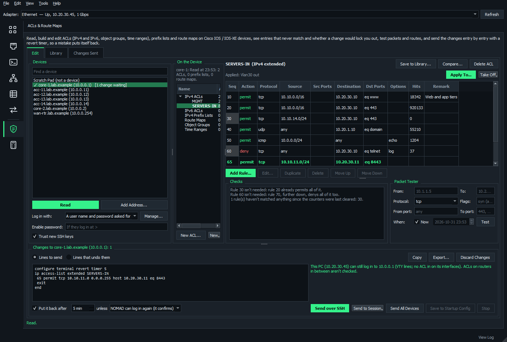

# ACLs and route maps

The **ACLs & Route Maps** page (under Network Management) reads the ACLs, prefix lists and route maps of Cisco IOS / IOS-XE switches and routers, lets you edit them, and sends back only what changed.

It's built so a change can't leave a device without its ACL or lock you out of it.

**On this page**

- [How it works](#how-it-works)
- [Read a device](#read-a-device)
- [Edit ACLs](#edit-acls)
- [Checks](#checks)
- [Packet Tester](#packet-tester)
- [Changes and the lockout check](#changes-and-the-lockout-check)
- [Send changes](#send-changes)
- [Library and history](#library-and-history)
- [Prefix lists and route maps](#prefix-lists-and-route-maps)

## How it works

1. **Read** the devices.
2. **Edit** ACLs, prefix lists or route maps. Nothing goes to the device yet.
3. Look at **Checks** and **Changes**.
4. **Send over SSH** with a revert timer.
5. NOMAD logs in again and confirms, or the device puts its old configuration back by itself.

## Read a device

1. Pick devices on the left: the open Network Map's switches and routers, saved SSH sessions, or **Add Address...**
2. Click **Read**.

NOMAD logs in over SSH (each device's saved session, or the login chosen; the enable password when it logs in at >) and reads its running-config, `show ip access-lists` and `show ipv6 access-list`.

You get:

- every ACL: IPv4 standard and extended, named and numbered, and IPv6
- object groups and time ranges
- where each ACL is applied: interfaces in and out, VTY lines, and anything else naming one, such as an SNMP community or a route-map
- how many packets each rule has matched

**From the map:** right-click a switch or router > **Tools** > **ACLs & Route Maps...**, or a port's box > **ACLs on This Port...**

## Edit ACLs

### Rules

**Add Rule...**, **Edit**, **Duplicate**, **Delete**, and drag rules (or **Move Up** / **Move Down**) to reorder them.

A rule has:

- a protocol
- source and destination, typed as `10.1.0.0/16`, a host, `any` or an object group, or picked from IP Addresses or the map's devices and subnets
- ports by number or name, ICMP messages and established
- a time range, logging and a remark

A subnet mask typed where a wildcard goes is turned into the wildcard. New and changed rules are shown in green.

### Sequence numbers

The **Seq** column shows the number each rule will have once sent, such as `30 (was 10)` for one renumbered.

Double-click it (or press F2), or use **Number** in the rule box, to type a number. The rule moves to its place by that number. A number another rule keeps is refused, and leaving it empty means an automatic one.

IOS can't renumber a single rule, so a rule given a new number is taken out and put back at it.

### ACLs and objects

- **New ACL...** makes one.
- **Apply To...** (beside where the ACL is applied, above its rules) puts it on an interface or VTY lines, in or out.
- **Take Off** and **Delete ACL** do what they say.
- **New** adds network and service object groups and time ranges, edited the same way.

## Checks

These run as you edit. Click a finding to see its rule.

- rules that never match, because an earlier rule takes everything they would
- rules that aren't needed, and duplicates
- a subnet mask written as a wildcard (`255.255.255.0` where `0.0.0.255` was meant)
- host bits IOS will quietly clear
- object groups and time ranges that aren't on the device
- ports on a protocol without them
- an IPv6 deny that drops neighbor discovery
- rules that haven't matched anything since the counters were cleared

## Packet Tester

Give a source, destination, protocol, ports (or ICMP message), TCP flags and a time. It says which rule matches and whether the packet is permitted, and what the device does with it now if that's different.

## Changes and the lockout check

**Changes** shows exactly the lines that will be sent, and the lines that undo them.

### How rules are changed

Rules are changed by sequence number. The ACL is never deleted and typed in again.

| Change | How it's sent |
| --- | --- |
| Added | Goes in at a free number between its neighbors |
| Changed | Goes in at a new number before the old one is taken out, so there's never a moment without it |
| Moved | Taken out and put straight back at its new place (IOS quietly drops a rule it already has, so it can't be added first) |
| No free number | `ip access-list resequence` makes room first, leaving round numbers for new rules |

In a standard ACL, IOS lists and renumbers single addresses first, in an order of its own. NOMAD plans with that order, and doesn't move single addresses when the order makes no difference. IOS won't take a single address after a rule that covers it, which Checks shows as an error.

### Lockout check

Before sending, NOMAD checks that this PC could still log in:

- the VTY lines' access-class
- the inbound ACL on the interface this PC's packets come in on (read with `show ip cef`)
- the inbound ACL on the interface holding the device's address

If it couldn't log in, **Send** stays off until you tick that you can reach the device another way, such as the console. A refusal the device gives as it is now too is only a warning, since NOMAD did log in to it. ACLs on routers in between aren't checked.

## Send changes

### Send over SSH

**Send over SSH** goes in with a revert timer (**Put it back after**, on by default, 5 minutes). It uses `configure terminal revert timer`, so the device puts its old configuration back by itself unless it's told `configure confirm`.

1. NOMAD sends the lines.
2. NOMAD logs in again.
3. If that works, NOMAD sends `configure confirm`.

With **unless I click Confirm**, you check things yourself first. The device waits, with a countdown, for **Confirm** (`configure confirm`, from a new login) or **Put Back Now** (`configure revert now`). Nothing more goes to it until then.

| If this happens | Then |
| --- | --- |
| A line is refused, or the new login fails | NOMAD sends `configure revert now` straight away |
| NOMAD can't even do that | The device reverts when the time's up |
| The device has no archive path | NOMAD sets `archive` / `path` on its flash, and says so |

Afterwards the device is read again, so the numbers and counts shown are its own. **Save to Startup Config** (`write memory`) is offered once a change is confirmed. Nothing is saved otherwise.

**Send All Devices** sends every device with changes waiting, one after the other, and stops at the first that doesn't take them.

### Send to Session

**Send to Session** types the same lines into a terminal session instead, to watch them or for a device with Telnet only. With the revert timer on, log in again from another session to check you still can. Then **Confirm** or **Put Back Now** types the command into that session.

**Copy** and **Export...** give you the lines.

## Library and history

- **Save to Library...** keeps an ACL on this PC with the object groups and time ranges it names.
- **Use on This Device** merges it rule by rule into the ACL of the same name, leaving matching rules alone, or makes it.
- **Put on Devices...** does that for several devices, read first, ready for **Send All Devices**.
- **Import Text...** takes ACLs pasted from a configuration.
- **Scratch Pad**, at the top of the device list, is a place to build an ACL from nothing.
- **Compare...** shows how an ACL differs from the ACL of the same name on other devices read.
- **Changes Sent** lists every change sent from this PC, with its lines and what undoes them: **Undo over SSH** (with the revert timer, when it's on), **Undo in Session** or **Copy Undo**.

## Prefix lists and route maps

The same page reads, edits and sends a device's IPv4 and IPv6 **prefix lists** and its **route maps**, listed under the ACLs. They share the device list, Changes box, revert timer, Library and Changes Sent.

A change touching an ACL, the prefix list a route map matches and the route map goes out together, in the right order.

### What's read

- every prefix list, with its description and how many routes each entry matched (`show ip prefix-list detail`)
- every route map: each entry's description, match and set lines and continue, and policy routing counts (`show route-map`)
- where each is used: BGP neighbors and peer groups (in or out, per address family), redistribution and `default-information originate`, policy routing (`ip policy route-map`, `ip local policy`), distribute lists, OSPF area filter lists, and anything else naming one
- BGP neighbors, routing processes, AS-path lists and community lists

### Edit

**Add Entry...**, **Edit**, **Duplicate** and **Delete**. Drag entries or type numbers into **Seq**, the same as ACL rules.

- **Prefix list entry:** a prefix with `ge` / `le`. It says in words what it matches, and clears host bits as IOS does.
- **Route-map entry:** permit or deny, a description, match lines, set lines and **continue** (BGP). All match lines have to match, and the values on one line are any of them. Prefix lists, ACLs, AS-path and community lists on the device are offered.
- **New** > **Prefix List...** / **Route Map...** starts empty, as a copy, or from the Library.
- **Apply To...** puts it on a BGP neighbor or peer group, a redistribution (an existing one, or a new one, which starts redistributing), policy routing, or a distribute list or OSPF area filter.
- **Take Off** takes it off. A redistribution stays, without the route map.

### Checks

- prefix list entries that never match or aren't needed
- `ge` / `le` IOS won't take
- a list with no permit
- route-map entries after one that matches everything
- prefix lists, ACLs and AS-path lists that aren't on the device
- an ACL and a prefix list in one entry (IOS refuses that)
- continue going backwards
- set lines on a deny
- match lines IOS doesn't support where the map is used, such as AS-path or community matches on an OSPF redistribution, or a tag match on BGP in

IOS warns about that last kind and acts as if there were no match lines, so NOMAD's send takes the warning as a refusal and puts the change back.

### Route Tester

Give a prefix, plus for a route map a next hop, AS path, communities, tag, metric and local preference. It says which entry takes it, permit or deny, following continue, and what the route map sets. It tests the list or map as it will be once sent, and shows what the device does now if that's different. AS-path and community lists are matched the way IOS does (`_` and all).

### How changes go

**Prefix lists:**

- IOS won't change an entry at its number or hold the same entry twice, so a changed entry goes in at a new number before the old one is taken out.
- A moved entry is taken out just before its new place goes in.
- There's no resequence for prefix lists, so with no number free the entries are renumbered one by one.
- Deleting a prefix list deletes its description too (IOS keeps it otherwise).

**Route maps:**

- An entry is changed where it is.
- Match values are added before the old ones go (IOS adds match values up).
- Set lines are taken out before new ones go in (`set community` adds to what's there).
- Descriptions are cleared and typed again (each description line adds one).
- An entry that moves is made at its new number before the old one goes, and a continue pointing at it follows it.
- An entry is always named with its number, since `no route-map NAME` alone would delete the whole map.

### BGP soft clear

BGP only puts routes it has already learned through a changed policy after a soft clear. Once a change touching a BGP neighbor's policy is confirmed, the neighbors it affects are listed with the command for each, none ticked:

- `clear ip bgp 10.1.1.1 soft in`
- `clear bgp ipv6 unicast ... soft out`
- `clear ip bgp vrf RED ...`

Peer groups are covered too. **Soft Clear Ticked** sends the ticked ones over SSH, or types them into the session the change went to. There's also **Copy Commands** and **Not Now**. The sessions stay up.

### Library

A prefix list, or a route map with the prefix lists and ACLs it matches, is saved and merged into devices the same way as ACLs. Entries already there are left alone.
