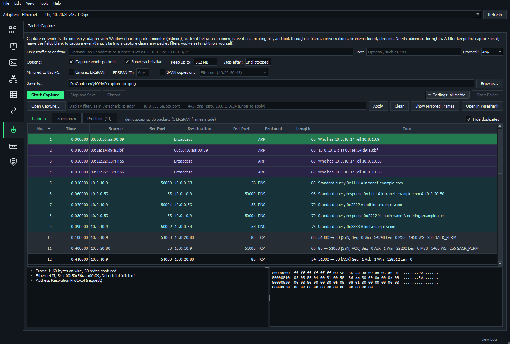

# Packet capture and port mirroring

**Packet Capture** records and reads traffic with nothing to install. **Port Mirroring** gets the traffic you want to it. Both are under Capture & Logs.

**On this page**

- [Capture packets](#capture-packets)
- [Look through a capture](#look-through-a-capture)
- [Mirror a port](#mirror-a-port)

## Capture packets

**Packet Capture** records with Windows' own packet monitor, pktmon (administrator rights needed). Packets show in the viewer as they're captured, and **Stop and Save** opens the saved file there.

**Open Capture...** opens any pcapng or pcap file, from Wireshark or tcpdump too.

### Settings

- **Filter:** an address or subnet, a port or a protocol keeps a capture small.
- **Capture whole packets** keeps all of each one, which you need to follow streams. Untick it to keep only the headers of long captures.
- **Stop after** stops and saves on its own.
- The settings fold away (the **Settings** button says what a capture would take) to give the packets room. They fold away by themselves once a capture starts.

### Show packets live

On by default. Packets appear about a second after they're captured, with the filter, summaries and problems kept up to date (summaries and problems every few seconds).

- **Follow newest** keeps the newest in sight. Scrolling up stops it, and scrolling back to the bottom starts it again.
- NOMAD listens to the events pktmon logs while pktmon writes its file as usual, so the saved file is always the whole capture.
- On a very busy link (more than about 15,000 packets a second), the live view falls behind or misses some, and says so. After Stop and Save, the viewer opens the file with everything.

### SPAN copies on

A switch mirroring (SPAN or RSPAN) to this PC's wired port sends copies addressed to other machines, which an adapter normally throws away.

Tick **SPAN copies on** and choose the adapter. It's held in promiscuous mode while capturing, using Windows' own SIO_RCVALL, so no Npcap is needed.

- The adapter needs an IPv4 address. On a SPAN destination port it usually gets a 169.254 one.
- Some adapters drop 802.1Q-tagged frames (with `encapsulation replicate`) before anything sees them.

### Unwrap ERSPAN

For a switch mirroring here over ERSPAN, **Stop and Save** also saves the mirrored frames as their own capture.

The viewer unwraps them by itself too: a capture that's mostly ERSPAN opens showing the frames mirrored. **Show as Captured** shows the GRE packets.

## Look through a capture

### Packets

- The list gives each packet's source and destination ports their own columns.
- Packets are colored as Wireshark colors them: resent and reset in red, ARP, spanning tree and CDP/LLDP, names, routing protocols.
- Select a packet to see it decoded line by line, and its bytes, with the part a line is about highlighted.
- Right-click a packet to follow its stream, show only its conversation or address, or hide its protocol.
- A packet captured twice (pktmon sees some at more than one point) is hidden. Untick **Hide duplicates** to see them.

### Filters

Filters are written as in Wireshark:

| Filter | Finds |
| --- | --- |
| `ip.addr == 10.0.0.5 && tcp.port == 443` | Traffic to or from an address on a port |
| `dns` | A protocol |
| `!arp` | Everything but a protocol |
| `ip.src == 10.1.0.0/16` | A source subnet |
| `eth.addr == 00:11:22:33:44:55` | A MAC address |
| `tcp.port in {80 443}` | Any of several ports |
| `dns.qry.name contains "corp"` | Part of a name |
| `tcp.analysis.retransmission` | Resent packets |
| `frame contains "password"` | Text anywhere in a packet |

Just an address, a subnet, a MAC address or a port number works too.

To build a filter by clicking:

- Right-click a packet > **Add to Filter**, **Add to Filter with Or** or **Exclude from Filter**, and pick its address, port, VLAN, protocol or conversation. The one in the column you right-clicked is first, in bold.
- Right-click any line of the decoded packet (a source address, a TTL, a flag, a DNS name) for that field, or the protocol it's under.
- **Show Only This** replaces the filter instead.

Filters work while capturing live. Field names complete as you type, and the box turns red with the reason while a filter doesn't make sense.

**Open in Wireshark** opens the file there with the same filter.

### What's decoded

| Layer | Protocols |
| --- | --- |
| Core | Ethernet, 802.1Q, ARP, IPv4/IPv6, ICMP, UDP |
| TCP | With Wireshark's analysis: relative sequence numbers, retransmissions, duplicate ACKs, zero windows, gaps |
| Services | DNS, DHCP, TLS (the server name asked for), HTTP, SMB2, SNMP, syslog, NTP, TFTP, RADIUS, 802.1X |
| Switching | CDP, LLDP, STP/RSTP/PVST+, LACP, DTP, VTP |
| Routing | HSRP, VRRP, OSPF, EIGRP, IGMP, PIM, BGP |
| Tunnels | GRE, ERSPAN, VXLAN |

Anything else is named by its port.

### Summaries

- conversations (IP, TCP, UDP, Ethernet) and top talkers, with names learned from DNS answers and DHCP
- the protocols
- traffic over time (click a bar for its packets)
- the devices heard announcing themselves over CDP/LLDP, which tells you which switch and port this is

Double-click a row to see its packets.

### Problems

What's worth a look, worst first. Double-click one, or click **Show These Packets**, to see its packets.

| Area | What it finds |
| --- | --- |
| TCP | Resends, connections refused or unanswered, slow handshakes, zero windows |
| The capture | Packets missing (on a mirror, usually the destination can't take what the ports carry); only one direction captured (a mirror of rx or tx only, or replies taking another path) |
| DNS and DHCP | DNS failures and slow answers; DHCP with no offer, or from two servers (a rogue one?) |
| Addressing | Duplicate IP addresses, ARP nobody answers, ICMP unreachables |
| Switching | Spanning tree topology and root changes, broadcast storms, half duplex |
| Redundancy | Two HSRP or VRRP routers active |
| Services | 802.1X and RADIUS rejections, SMB, TLS and HTTP errors, SNMP with no answer |

### Follow Stream

Double-click a TCP or UDP packet to see what each side sent, in order and once, as text or a hex dump, with gaps marked. **Save As...** saves it.

A big capture file (hundreds of thousands of packets) takes some seconds to open.

## Mirror a port

**Port Mirroring** copies a port's traffic, or a VLAN's, to where it can be captured, on Cisco IOS / IOS-XE switches and routers from the open Network Map. It takes the mirror away again afterwards.

1. Choose the source: a switch or router and its ports.
2. Choose the destination.
3. Click **Plan** to check it.
4. Click **Set Up**.
5. Capture.
6. Take it away, or let the timer do it.

### Choose what to copy

Choose the switch or router, then **Add Ports...**, **Add VLAN...**, or **Add Host...** (by MAC, IP address or name, as the map has it). For each, choose whether to copy what it receives, sends, or both.

Then choose where the copies go: **A switch port**, **This PC**, or **An address** (a capture box, over ERSPAN).

**From the map:**

- right-click a port's box > **Mirror This Port...** or **Mirror to This Port...**
- right-click a switch or router > **Tools** > **Mirror Ports...**
- right-click a host on the Hosts tab > **Mirror This Host's Port...**

### The kind is picked for you

Or choose it under **Kind**.

| Kind | When | How |
| --- | --- | --- |
| **SPAN** | The destination is on the same device | Local session |
| **RSPAN** | The map joins the two switches by switched links | A VLAN no switch on the map has (from 999 down) is made `remote-span` on each switch along the way and added to trunks that don't allow it (`allowed vlan add`, never replacing the list) |
| **ERSPAN** | Only routers join them, or to an address | IOS XE: Catalyst 9000, 3650/3850, ISR/ASR, CSR. Sent from the source device's management address |

**More Options** picks a loopback or VLAN interface instead, a VRF, the ERSPAN ID and the session number.

### Plan

Plan checks first and changes nothing. It logs in over SSH (each device's saved session, or the login chosen; the enable password when they log in at >) and reads their sessions, so a free session number is used and a port already in one isn't.

- A destination port stops passing normal traffic, so a link to another network device, a trunk or a port-channel is never used as one.
- It warns about devices on the destination port that would lose the network, and sources adding up to more than it takes.

### Set Up

**Set Up** sends each device its lines over SSH (the destination first and the source last, so copies start once there's somewhere for them), then reads the devices to check they show it.

- If a device refuses a line, NOMAD offers to take back what it already set up.
- **Send** on each device's row types its lines into a terminal session instead, to watch or for a device with Telnet only.
- **Copy All** and **Export...** give you the lines and what undoes them.
- Nothing is saved to the startup configuration.

### Remove after

**Remove after** (on by default, 60 minutes) adds an EEM applet with a countdown to each device. When the time's up, the device takes its part away itself, logs a syslog message and deletes the applet, even if this PC has gone.

A device that refuses the applet has NOMAD take its part away when the time's up, while NOMAD is open.

### Mirrors

**Mirrors** lists every mirror set up from this PC, with exactly what takes it away.

- **Take Away** sends it over SSH. **Take Away in a Session** types it into a terminal session.
- **Check Now** reads the devices to see whether each is still there, and lists every session they have, NOMAD's or not. Right-click one to take it away.
- **Read All Devices** does that for every switch and router on the map.

### Mirror to this PC

NOMAD looks for the adapter chosen on the map.

| Where the PC is | What happens |
| --- | --- |
| Plugged into a free port of its own (a second adapter) | Copies go out of that port. **Capture Here** opens Packet Capture with **SPAN copies on** that adapter. |
| On the adapter this PC reaches the devices through, on Wi-Fi, or on a port the map doesn't have | Copies go to its address over ERSPAN, so a wired port keeps working. **Capture Here** opens Packet Capture ready to capture what the source device sends and, with **Unwrap ERSPAN**, saves the mirrored frames as their own capture, as if this PC were plugged into the mirrored port. |
