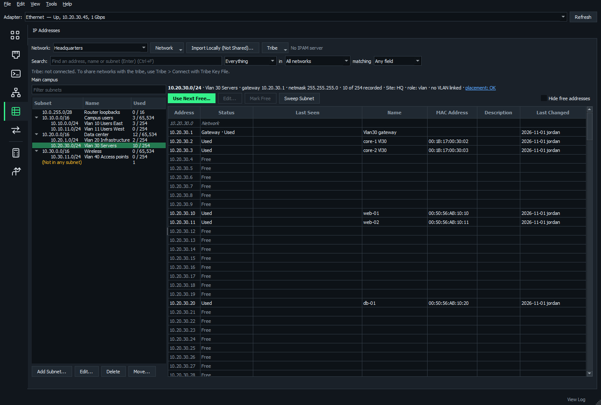
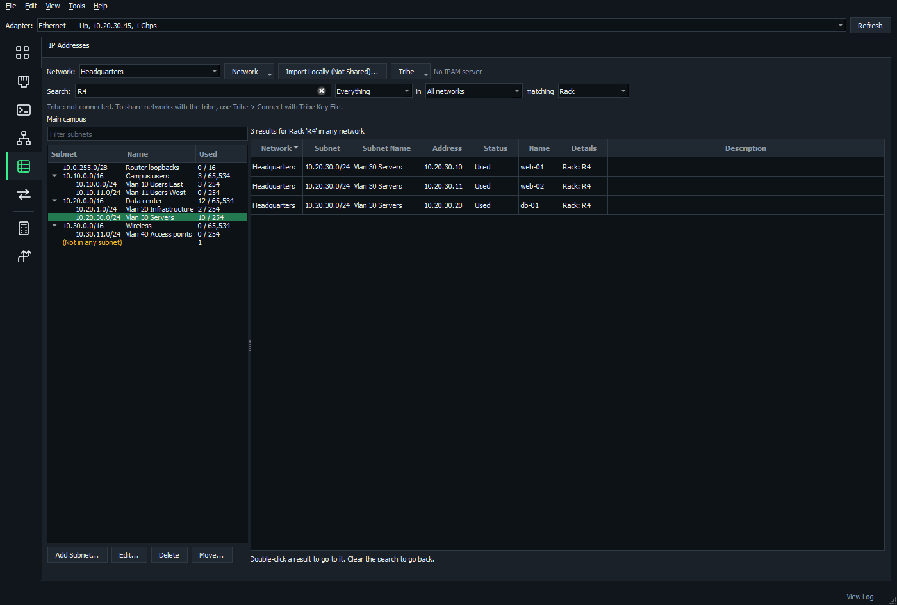
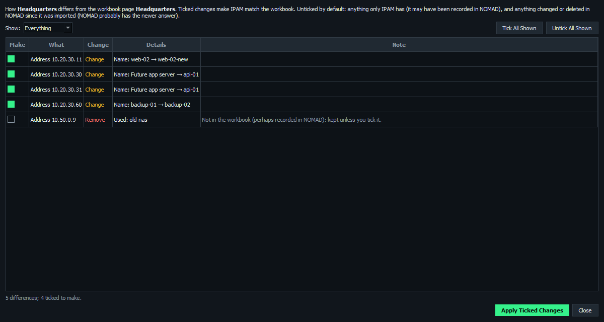
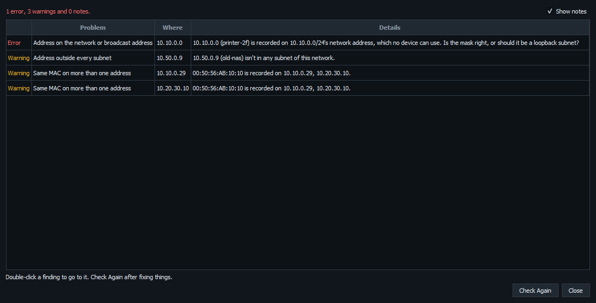

# IP address management and the tribe

The **IP Addresses** page keeps track of addresses for several separate networks, such as air-gapped ones that reuse the same ranges. Share them with your team (the *tribe*) through a server, and keep working offline.

**On this page**

- [Everyday use](#everyday-use)
- [Sweeps and Last Seen](#sweeps-and-last-seen)
- [Search](#search)
- [Workbooks](#workbooks)
- [Check data and history](#check-data-and-history)
- [Share with the tribe](#share-with-the-tribe)
- [Maps and IPAM together](#maps-and-ipam-together)
- [Move the server to another computer](#move-the-server-to-another-computer)

## Everyday use

### Addresses and subnets

- **Subnets as a tree:** blocks hold the subnets inside them, each with how much is used.
- **Every address** in a subnet shows as used, reserved or free, or as its network, broadcast or gateway address.
- **Use Next Free** records the lowest free address.
- **Loopback subnets:** every address is its own /32, with no network, broadcast or gateway address.
- **Select several** addresses or subnets to change them together.
- **Find Free Blocks** (right-click a subnet) shows the unused space in it, ready for new subnets.

### Add or delete a subnet

- **Add Subnet...** can say what the new subnet is for, and link it to a VLAN of the network's domains (the next free number, or an existing one).
- **Delete** takes its VLAN links, role and placement settings with it. It won't while the subnet is being moved on Subnet Placement.
- Subnet Placement flags links or settings left behind for a subnet no longer in IPAM.

### Move a subnet to another network

For when a plan changes after the import and a block belongs to another enclave's page. Right-click a subnet > **Move to Another Network**, or use **Move...** under the subnet list.

- You choose whether the subnets inside it go too.
- Its recorded addresses, role and Subnet Placement settings go with it.
- Its VLAN links are dropped, and a VLAN of the new network can be linked instead (the same number, if it has one).
- An overlapping subnet, an address recorded in it, or a placement move under way stops it.
- Tribe networks move on the server. This computer's networks can move into the tribe's, never the other way.
- The old network's history keeps what it had, and the new one shows it added.

### Add a Windows route to a subnet

Right-click a subnet > **Add Windows Route...** opens the Routing Table with the route filled in, filtered to what carries traffic to that subnet now. If this computer already has an address in the subnet, it says so.

### Get a free address on the Interfaces page

**Free Address from IPAM** on the Interfaces page fills in the next free address, mask and gateway. It records the address in IPAM once you keep the new settings.

## Sweeps and Last Seen

**Sweep Subnet** pings every address in place. **Last Seen** shows when each address last answered:

| Color | Meaning |
| --- | --- |
| Red | IPAM says used, but nothing answered |
| Amber | Something answered that IPAM doesn't have |

- **Record Answering Devices** and **Update MACs** save what a sweep found.
- Sweep results are kept, and shared through the IPAM server with who swept, including sweeps made offline.

## Search

Search every network, or narrow it to subnets, addresses, one network, or one field (such as a name, a MAC, or a detail column from your workbook).

## Workbooks

### Import

The import button reads your addressing workbook (`.xlsx`, a network per page, or a `.csv` of one page). It says **Import Locally (Not Shared)...** on a laptop, and **Import to Tribe Server...** on the tribe server.

- Where a page's summary and detailed listing disagree, you choose which to keep.
- Impossible gateways get a suggested fix.
- Unusable rows are listed by row number.
- SNMP strings are never imported.

### Export

**Export to Workbook** writes networks back in the same layout, and it imports back unchanged. **Export to CSV** is there too.

### Compare

**Compare with Workbook** lists every difference from a newer copy of the workbook to tick and apply, instead of importing it again. Edits made in NOMAD since the import are left unticked.

## Check data and history

**Check Data** lists likely mistakes, most serious first. Double-click one to go to it. It looks for:

- a device on a network or broadcast address
- addresses outside every subnet
- names that look like a stray note
- "Loopback" subnets not marked as loopbacks
- duplicate MACs, and more

**History** shows every change, with who made it and when, for an address, a subnet or the whole network.

**View As Of** shows a network as it was at any moment.

## Share with the tribe

Networks are either **Local** (on this computer) or **Tribe** (shared by an IPAM server on one always-on Windows machine).

### Set up the server

1. On the server machine, run NOMAD as administrator and open **Tools** > **Tribe Management...**
2. Click **Install Service**. It sets up the database, a certificate and nightly backups (kept 14 days) in `%ProgramData%\NOMAD\server`, installs the NOMAD IPAM Server service, and opens TCP port 8443.
3. Click **Save Tribe Key File**, and give it only to the tribe. Anyone with it can change the tribe's IPAM.
4. After updating NOMAD, click **Update Service** in the same window.

NOMAD checks the server's version each time it starts and when you connect. If the server is older than your copy of NOMAD needs, a banner names the version to update to, and **How to Update...** shows the steps and what the update brings. The server keeps working in the meantime. The banner goes away once the server is updated. A server newer than your copy is fine.

**Change Tribe Key** locks out every old copy.

Spreadsheets are imported, and tribe networks added or deleted, only in NOMAD on the server itself, running as administrator. The one exception is [sharing a Local network with a map](#share-it-with-a-map).

### Connect each laptop

Use any one of these. Each connects both IPAM and tribe maps:

- **Tribe** > **Connect with Tribe Key File...** on the IP Addresses page
- **Map** > **Tribe** > **Connect to the Tribe with a Key File...** on the Network Map page
- **Connect with Key File** in **Tools** > **Tribe Management...**

The laptop keeps a copy of the tribe's networks and history, so lookups work offline. It syncs the moment anyone changes anything.

**Disconnect from the Tribe** in Tribe Management is the only place to leave. It forgets the key and the copies of the tribe's networks and maps.

### What the tribe shares

| What | How it gets shared | While the server can't be reached |
| --- | --- | --- |
| Networks | Created on the server, or shared from a laptop with a map | Read only |
| Subnets | Added to a tribe network | Read only |
| Addresses | Added to a tribe network | Changes wait until the server is back |
| Sweep results | Saved with a tribe network | Sent with the next sync |
| VLANs | Added to a **Tribe** domain on the **VLANs** page | Changes wait, but new domains need the server |
| Subnet roles and placement | Set on a tribe network | Read only |
| Assets | Added to the **Tribe** list on the **Assets** page | Changes wait until the server is back |
| Software targets | Set on the **Tribe** list on the **Assets** page | Read only |
| Maps | Shared from the **Network Map** page | Changes wait, but sharing a new map needs the server |
| A map's SNMP credentials | Shared with the map | Changes wait until the server is back |

Local networks, terminal sessions, saved credentials and interface profiles are not shared.

### Share IPAM networks

Tribe networks are created on the server:

1. On the server, run NOMAD as administrator and open **IP Addresses**.
2. Click **Network** > **New Network...** or **Import to Tribe Server...**

Every connected laptop gets the new network. Anyone in the tribe can then add subnets and addresses to it.

### Share a Local network

**New Network...** and **Import Locally (Not Shared)...** on a laptop only create Local networks, even while the laptop is connected to the tribe. There are three ways to share one.

#### Share it with a map

Use this when you are sharing a map of the network. It moves the whole network and creates a new tribe network, so it does not need an administrator. The laptop must be able to reach the server, and the server must be updated with **Update Service**.

1. Open the map and click **Map** > **Tribe** > **Share This Map with the Tribe...**
2. Under **IPAM network**, select the Local network. It says **share it with the tribe**.
3. Change **Name in the tribe** if you want to.
4. Read the summary and click **OK**.
5. Click **Yes** to confirm. Clicking **No** moves nothing and leaves the box open.

If the map is already a tribe map, use **Map** > **IPAM Network...** instead.

The subnets, addresses, roles and Subnet Placement settings all go, along with the network's VLAN domains and their VLANs. It all goes at once, or nothing does. NOMAD stops if the tribe already has a network or VLAN domain with the same name, or if a subnet is being moved on Subnet Placement.

The network then leaves your computer, and it can't be moved back to Local. Only the tribe server can delete it. Your other maps of it on this computer switch to the tribe network. Its history and Last Seen results are not carried over.

#### Move its subnets

Use this when the tribe network already exists. The laptop must be able to reach the server.

1. On the **IP Addresses** page, right-click a subnet and click **Move to Another Network**.
2. Under **To**, select the tribe network.
3. Under **VLAN there**, link the subnet to one of that network's VLANs, if you want to.
4. Read the summary and click **Move**.

The subnet takes its recorded addresses, role and Subnet Placement settings with it. Subnets inside it go too, unless you untick that option. Its VLAN links are dropped, and its history stays with the old network.

The subnet leaves your computer's networks. It can't be moved back from the tribe to Local.

#### Use a workbook

Use this to share a whole network at once.

1. On the laptop, select the network and click **Network** > **Export to Workbook...**
2. Copy the workbook to the server.
3. On the server, run NOMAD as administrator and click **Import to Tribe Server...**
4. On the laptop, delete the Local copy with **Network** > **Delete Network...**

The workbook carries the subnets and addresses. It does not carry the network's history, VLANs or subnet roles.

### Share a map

1. Open the map on the **Network Map** page.
2. Click **Map** > **Tribe** > **Share This Map with the Tribe...** and give the map a name.
3. Under **IPAM network**, select the tribe network the map belongs to. NOMAD suggests the network holding most of the map's subnets.
4. Click **OK**.

If the map's network is still on your computer, you can [share it with the map](#share-it-with-a-map) in step 3. You can also leave it as **none chosen**, and anyone in the tribe can choose later.

Sharing a map needs the server. The map's SNMP credentials go with it, so everyone with the tribe key can use them.

For what's shared and how changes merge, see [Tribe maps](network-map.md#tribe-maps).

### Offline and conflicts

- **Offline**, you can still assign, edit and free addresses. Changes wait as *pending* and are sent in order when the server is back.
- If someone else changed the same address first, **Review Refused Changes** lets you take the next free address, or discard yours.
- Subnets and networks can only be changed online.

### Troubleshooting

Stop the service and run `NOMAD.exe --ipam-server` to run the server in a console. Its log is `%ProgramData%\NOMAD\server\server.log`.

## Maps and IPAM together

Maps and IPAM networks use the same server and the same tribe key, but they are separate things. A map's data is not IPAM data, and sharing a network does not share a map. The link between them is the map's **IPAM network**.

### Tie a map to a network

1. Open the map on the **Network Map** page.
2. Click **Map** > **IPAM Network...**
3. Select the network and click **OK**. NOMAD suggests the one holding most of the map's subnets.

The link is saved with the map, so a tribe map's link is shared with everyone. A tribe map with no link asks for one the first time each computer opens it.

### Use a tribe network for a tribe map

A Local network only exists on your computer, so nobody else can use a link to it. A tribe map can't be tied to one.

For a tribe map, **Map** > **IPAM Network...** lists the tribe's networks, and offers to [share](#share-it-with-a-map) each Local network first.

Tribe maps shared by older versions of NOMAD may have a link to a Local network. NOMAD now treats that as no link, so the map asks for a network when it is opened. The first answer sets it for everyone.

If you move a map's subnets from a Local network into a tribe network, select the tribe network under **IPAM Network...** yourself. Only sharing the whole network updates the link for you.

### What the link gives you

| Where | What you get |
| --- | --- |
| Hosts tab on the map | An **IPAM** column: in IPAM with its name, not in IPAM, or IPAM has another MAC address |
| Logical view of the map | Each subnet's IPAM name and role, and an outline when Subnet Placement finds a problem |
| **Record in IPAM...** on the map | Saves the addresses IPAM is missing to the tribe network, for everyone |
| **On Map** column on **IP Addresses** | Where the map has each address |
| Subnet line on **IP Addresses** | The subnet's role, VLANs, placement and how many places the map has it in |
| **VLANs** and **Subnet Placement** pages | The network's plan checked against what the map found |
| Watch log on the map | New hosts and subnets the network doesn't have |

Choosing the network on one page chooses it on the others, and opening the map chooses its network. For more, see [The pages and the map together](vlans-subnets-assets.md#the-pages-and-the-map-together).

### Good to know

- **Nothing from the map reaches IPAM on its own.** Crawling, watching and the Map Watcher service don't change IPAM. Addresses are only saved when someone clicks **Record Ticked** under **Record in IPAM...**
- **Record in IPAM works offline** for tribe networks. The addresses wait as pending, like any other offline change.
- **The On Map column uses the map open on your computer.** Two people with different maps open see different results, and with no map open it stays empty.
- **Assets are separate from the link.** **Bring in after each crawl** adds hardware to the list showing on the **Assets** page. Select the **Tribe** list there to share what a crawl finds.

## Move the server to another computer

1. **On the old server** (NOMAD as administrator): **Tools** > **Tribe Management...** > **Move to Another Computer...** Give the new server's name and/or IP address (if known) and a password, then save the move file. It holds everything: networks and history, tribe maps and their SNMP credentials, the certificate and the tribe key.
2. **On the new computer** (NOMAD as administrator): **Set Up from Move File...** in the same window. It installs the service with the same data, certificate and tribe key.
3. **Wait for the laptops.** The old server now only points laptops and the Map Watcher service to the new address. They switch over the next time they reach it, keeping their copies and pending changes.
4. **Finish.** Leave the old server running until every laptop has switched, then **Uninstall** it. Delete the move file.

If no address was given, give the laptops the new server's tribe key file instead. They still keep their copies and pending changes.

The old computer carries on as a member of the tribe by itself. **Undo Move...** on the old server puts it back in service, if the move is called off before anyone uses the new one.
