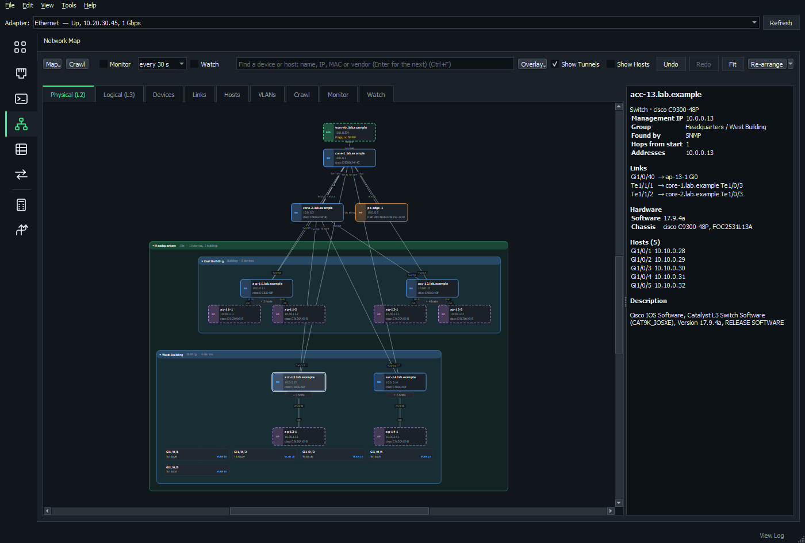
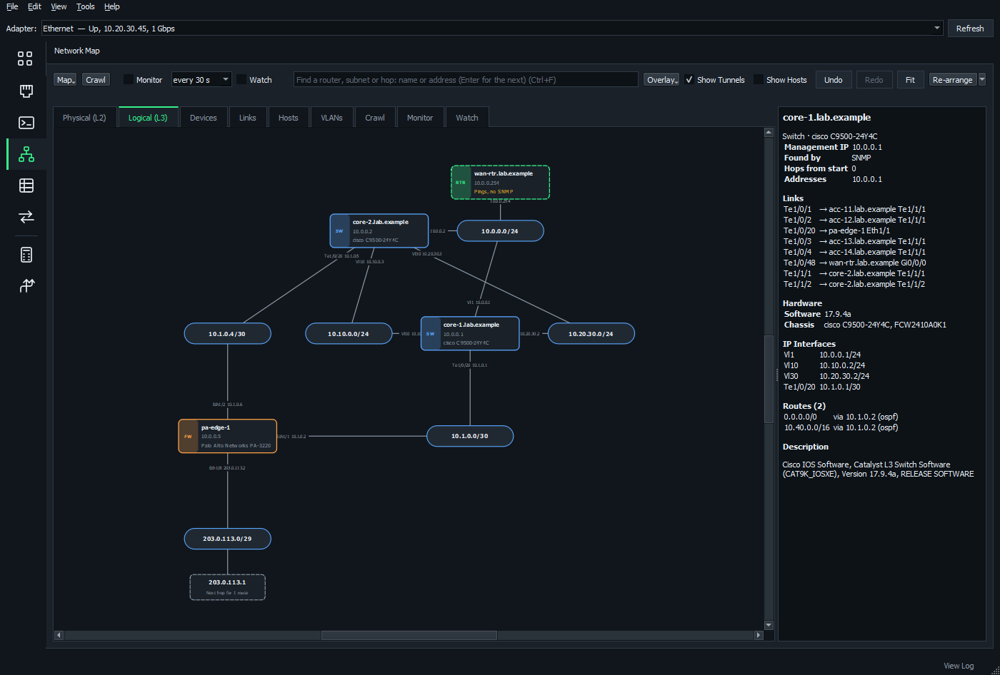

# Network map

The **Network Map** page crawls your switches, routers and firewalls over SNMP and draws what's plugged into what.

Nothing needs installing on the devices, and crawling changes nothing on them.

**On this page**

- [Make a map](#make-a-map)
- [Read the map](#read-the-map)
- [The top bar](#the-top-bar)
- [Move around and find things](#move-around-and-find-things)
- [Add things by hand](#add-things-by-hand)
- [Sites and buildings](#sites-and-buildings)
- [Arrange the map](#arrange-the-map)
- [Overlays](#overlays)
- [Monitor devices](#monitor-devices)
- [Links that are gone](#links-that-are-gone)
- [Watch for new devices](#watch-for-new-devices)
- [Tribe maps](#tribe-maps)
- [Map Watcher service](#map-watcher-service)
- [Save, export and compare](#save-export-and-compare)
- [Add addresses from other pages](#add-addresses-from-other-pages)

## Make a map

1. Give your devices read access over SNMP. [SNMP Config](snmp-config.md) builds that configuration for Cisco switches.
2. Enter a core switch or your gateway, or click **Adapter's Gateway**.
3. Click **SNMP Credentials...** and add your community strings or SNMPv3 users.
4. Click **Start**.

NOMAD reads the device's CDP and LLDP neighbors, asks each neighbor for its neighbors, and so on.

### While it maps

- The map is drawn as devices are found. Devices being read are ringed in green, and you can drag things around meanwhile.
- A progress bar shows how many devices are read, being read and queued, the time taken and roughly how long is left.
- The **Crawl** tab shows what each device being read is doing (which table, which VLAN, which community string).
- The same tab logs everything found and skipped, and why (outside the scope, too many hops, no answer). You can copy or save it.
- Community strings are never written to the log.

### SNMP credentials

**SNMP Credentials...** holds what to try, in order:

- community strings
- SNMPv3 users (MD5, SHA-1 or SHA-2 authentication; DES or AES-128/192/256 privacy)
- credentials for particular subnets, tried first there (type `v3:name` for a user)

Good to know:

- Credentials are saved encrypted for your Windows account. A tribe map's are shared with the tribe (see [Tribe maps](#tribe-maps)).
- SNMPv3 users are tried first unless you untick that. A switch without the user says so at once, while a wrong community string waits for the timeout.
- On Catalyst switches, per-VLAN MAC tables are read with `community@vlan`, or over v3 in the `vlan-` contexts.

### Scope

**Scope...** limits the crawl to:

- subnets (by default, any private address)
- a number of hops
- a number of devices

It also sets how many devices are read at once (16 by default, up to 64 for a big network). Devices outside the scope still appear as neighbors, just without their own neighbors.

## Read the map

### Colors and outlines

| What you see | What it means |
| --- | --- |
| Color of a device | Its kind: switch, router, firewall, wireless controller or access point |
| Dashed outline | NOMAD didn't read it itself: only seen as a neighbor, or it **pings but doesn't answer SNMP** (usually the community string or an SNMP ACL) |
| Red | It answered neither SNMP nor ping |
| Italic name | Added by hand |
| Dotted link | Drawn by hand |
| Faint dash-dot link | One end [stopped seeing it](#links-that-are-gone) |
| Small padlock | [Locked in place](#lock-icons-in-place) |

The **Key** (in the **Map** menu) shows all of this on screen.

**Palo Alto firewalls** are found through LLDP, so turn on an LLDP profile on the interfaces facing the switches.

### Hosts

Each switch's MAC table and the ARP tables of routers and firewalls put hosts on the edge ports they're plugged into.

- Hosts are hidden until you double-click a switch, or tick **Show Hosts** for every switch.
- You then get a box per port, listing each host with its VLAN.
- MACs learned on uplinks are left out.
- Phones get their names from CDP/LLDP.
- A port with many hosts and no neighbor is marked as a likely unmanaged switch or hypervisor.
- On Catalyst IOS, MAC tables are read per VLAN with `community@vlan`, several at once, for only the VLANs that access, voice and native trunk ports use.

### Logical (L3) view

The routers, L3 switches and firewalls, joined through the subnets they have addresses in, with the next hops their routes point to.

- Select a router to see its IP interfaces and routes.
- Select a subnet to see what's on it. Right-click it to sweep it.
- After the crawl, NOMAD traceroutes from this computer to what SNMP couldn't show: devices that didn't answer, next hops not on the map, and static routes' destinations.
- Those paths are drawn dashed, with `*` where a hop didn't answer. Turn this off under **Scope...**.

### Tunnels

The crawl reads each router's tunnel interfaces (TUNNEL-MIB) and, on Cisco, its IKE sessions that are up (CISCO-IPSEC-FLOW-MONITOR-MIB). **Show Tunnels** (ticked) draws them as thin dashed lines:

| Color | Meaning |
| --- | --- |
| Green | Up |
| Amber | Up, but IPsec isn't |
| Red | Down |
| Gray | Not known |

How the far end is worked out:

- **Point-to-point (GRE, IPsec VTI):** the line goes to the router with the far end's address.
- **DMVPN:** a router is joined to those it has IKE sessions with (a hub's spokes, a spoke's hubs and shortcuts).
- **DMVPN router with no session to its hub:** drawn to it as down or not encrypted, when the hub (the one with the most sessions) can be told.
- **Far end not on the map:** not drawn.

A router's details list its tunnels.

While **Monitor** is on, each poll reads tunnels and IKE sessions again, so the lines and **Overlay** > **VPN Tunnels** show the tunnels as they are now. Changes are noted in the Monitor log. Turning Monitor off puts them back as the crawl found them.

This is read-only SNMP, with no SSH. Tested on IOS XE 17.4 (C8000V).

### Aruba wireless

An ArubaOS 8 Mobility Controller the crawl reaches (start from it, or let a switch's LLDP lead there) is a **Wireless controller** (WLC). Give it a read community or SNMPv3 user, as for the switches. It's read-only.

- **Access points:** NOMAD reads each AP's name, address, AP group, model, serial number, software and up or down.
- **Placement:** an AP a switch's LLDP found gets the controller's details. One on no switch the map has sits beside its controller.
- **Down APs:** drawn in red.
- **Wi-Fi clients:** hosts on their AP, a box per SSID, with MAC, IP address, computer or user name, SSID and VLAN.
- **Overlay** > **Wireless** shows each AP's controller and whether it's up.

### pfSense

A pfSense box is mapped as a firewall. A crawl and **Read Hardware Again** also read how full its disks are, shown in the device's details. A ZFS pool shows as one disk. The firewall needs **Host Resources** ticked under Services > SNMP; if it gives no disks, the crawl log says so.

## The top bar

One row of buttons:

- **Map** holds New Map, Open, Recent, Save As, Export, Compare, Monitor from a Router, the tribe's maps and the **Key**.
- **Crawl** shows where to start from, to map again or crawl from another switch. It shows anyway while there's no map or a crawl is running.
- The status line keeps to one line. Hover over it to read all of it.

For two rows with the start row always showing, choose **View** > **Network Map Top Bar** > **Classic**.

## Move around and find things

| To do this | Do this |
| --- | --- |
| Zoom | Scroll |
| Pan | Drag the background |
| Move a device | Drag it (NOMAD remembers, even after mapping again) |
| Select several | Hold **Shift** and drag a box round them |
| Add or remove one from the selection | Ctrl+click |
| Select everything | Ctrl+A |
| Undo / redo moves, arranging and group changes | **Undo** / **Redo**, or Ctrl+Z / Ctrl+Y (last 100 changes) |
| Search the tab showing | Ctrl+F |
| Jump to a device or host | **Find**: name, IP, MAC or vendor |

**Ctrl+F** finds a device on either map, filters the rows of the Devices, Links or Hosts tab as you type, or finds text in the crawl log.

### Right-click a device

- **Connect:** SSH and the other sessions
- **Tools:** ping, SNMP and the rest
- **Crawl from Here:** adds what it finds to this map, reading only devices not read yet
- **Put at the Top**
- **Show In:** the physical or logical view, the Devices tab, the Links tab (all its links) or Assets

### The Devices, Links and Hosts tabs

These list everything, with Excel-style filters:

- Click the funnel at the left of a column's header (or right-click the header) to tick values, search them or sort.
- Filters on several columns combine, and the tab shows how many rows are left, such as Hosts (12 of 340).
- Double-click a row to see it on the map, or right-click it. On the Links tab, that shows both ends of a link.

## Add things by hand

### Hosts

A device that's turned off or unplugged while you map won't be found. To add it:

1. Right-click a switch, a port's box or the Hosts tab > **Add Host...**
2. Give its port and a name, IP or MAC.

Hand-added hosts are drawn dashed and kept when you map again. If one is later found for real, the crawl's entry takes over and keeps your name and note.

To remove hosts, right-click them, or select them on the Hosts tab and press Delete. A deleted host that's still plugged in comes back the next time you map.

### Devices

For something the crawl can't find (an unmanaged switch, or one SNMP can't reach):

- Right-click the map's background > **Add Device Here...** With no map open, this starts a new map.
- Or right-click a device > **Edit** > **Add Device Linked to This...**

Give it a name, IP address, kind and model.

A device with an address is checked over SNMP with your credentials, like the crawl's devices, and pinged while monitoring:

- Dashed with *Pings, no SNMP*: the community or an SNMP ACL is wrong.
- Red: it doesn't answer at all.

Hand-added devices are kept and checked again when you map again. Once the crawl finds the device (by its address or name), the crawl's entry takes over its links, hosts, group and note.

### Links

To link two devices yourself (a port with CDP and LLDP turned off, say):

1. Right-click one > **Edit** > **Draw Link from Here**.
2. Click the other.
3. Give the ports.

Or use **Add Link...**. A link drawn by hand goes once the crawl finds a link between the same two devices.

### Check SNMP again

**Check SNMP Again** (right-click > **Edit**) asks a device again with the credentials as they are now. One that answers is read, as with Crawl from Here. One that doesn't says why when it can (an SNMPv3 user it doesn't know, a wrong password).

## Sites and buildings

Select devices, then right-click > **Group** > **New Site or Building...** to draw a labeled box round them. A building can sit inside a site.

- Drag a device into a box to add it, or out to take it out.
- Drag a box's title to move everything in it.
- Double-click the title to collapse the group into one box that keeps its links. Finding a device inside opens it again.
- Select a group to see its devices, how many are down and its links out.

Groups are saved with the map, carried over when you map again, shown in the Devices tab's Group column and exported to draw.io as boxes.

## Arrange the map

**Re-arrange** lays the map out again. It orders each layer so links cross as little as possible and keeps each device near the ones it links to.

Devices with a single link (access points, say) sit in a grid under the device they hang off. When that device also has links down to others, the grid goes off to the side.

### Layouts

Re-arrange's arrow offers:

- **Layout:** Top to Bottom, Bottom to Top, Left to Right, Right to Left, Grid or Circle (rings round the core)
- **Spacing:** Compact, Normal, Roomy or Spacious. This draws devices closer or spreads them out without laying anything out again. Re-arrange uses it from then on.
- **Keep Sites and Buildings Together:** each group is laid out inside its own box, with the device that links out of it on top. Boxes are laid out as their links go, or tiled when nothing links them.

### Arrange part of the map

- Select several devices, then right-click (or use the arrow) to arrange just them where they are.
- **Spacing of the 5 Selected** draws just them closer or spreads them out, as they're arranged.
- Right-click > **Layout** to **Align** by left, center, right, top, middle or bottom edges, or **Distribute** them evenly.
- Right-click a group's title to arrange or space out just that group.
- Ctrl+click (or Shift-drag round) several sites, buildings or rooms, with devices too if you like. You can then drag, arrange, align or distribute them, and each group moves as one box.

### Lock icons in place

Right-click a device, subnet or hop > **Lock Position** (or **Lock 5 Selected**) so it can't be moved by accident. **Unlock Position** frees it.

- A group's menu has **Lock Its Devices** and **Unlock Its Devices**.
- The arrange menu has **Lock Selected**, **Unlock Selected** and **Unlock All**.

A locked icon shows a small padlock, which pictures of the map leave out. It can still be selected and used as normal.

| Action | What happens to a locked icon |
| --- | --- |
| Dragging a selection | It stays behind |
| Dragging a group's title | It stays, and the box stretches round it |
| Re-arrange, Put at the Top | They work round it, and anything landing on it is moved along |
| Arrange, space, align, distribute | It stays, and the rest fall in around the first locked one |
| Dragging it into or out of a group | Not allowed |
| Undo | Lock and Unlock are steps for Undo, and Undo can move it |

Each view (Physical and Logical) has its own locks. They're saved with the map and kept when mapping again.

On a tribe map, locks are shared with everyone, which needs the tribe server updated. On an older server they stay on this computer until it's updated. Someone on an older NOMAD can still move locked icons, and clears the locks when their copy saves the map.

## Overlays

**Overlay** on the top bar shows one thing at a time over the physical view. The rest fades (except with Color By), and a bar over the map says what it found and what each color means. **Show All** or Esc puts the map back.

| Overlay | What it shows |
| --- | --- |
| **Highlight VLAN**, **VRF** or **Subnet** | A subnet's gateways, the switches and links carrying its VLAN, and the switches with hosts in it |
| **Single Points of Failure** | Every device and connection that's the only way to part of the network |
| **What If It Fails?** | From a device's or link's right-click menu: what would be cut off and how many hosts, measured from the device put at the top |
| **Trunk and Port Problems** | The VLANs tab's checks, on the links |
| **Link Speed and Status** | Speed as color and thickness; links down at an end, speeds that differ, duplex mismatches |
| **Utilization and Errors** | While Monitor is on: green, amber over 30% busy, red over 70% or with errors; rates in each link's tooltip |
| **Spanning Tree** > a VLAN | Reads its switches, then shows the root bridge and blocking links |
| **Software Targets** | Each device on, behind or ahead of its model's software target (set on [Assets](vlans-subnets-assets.md#software-targets)) |
| **VPN Tunnels** | Tunnels between routers: green up, amber partly up, red down |
| **Wireless** | Controllers and APs: green up, red down, a dashed line from each AP to its controller |
| **Color By** | Kind, model, software version, site, VTP domain or mode, spanning tree mode, or AP group |

## Monitor devices

Tick **Monitor** and choose how often (every 10 s to 10 min) to ping every device on the map.

- Up: a green dot and the response time.
- Down: a red tint and how long it's been down. A device counts as down after missing two checks in a row, so one lost ping doesn't make it flap.
- The Devices tab gets a Status column to filter on.
- The **Monitor** tab logs each device going down or coming back. The history is saved with the map.
- Monitoring carries on while you use other pages, and starts again with NOMAD if it was on, even after Windows restarts.

### Devices this computer can't reach

Devices behind a VRF, or with no route back here, can be checked from a router on the map that reaches them. This works with Cisco IOS / IOS XE routers and L3 switches.

1. Right-click them > **Tools** > **Monitor from a Router...**, or click **Router Probes...** on the Monitor tab (or **Monitor from a Router...** in the **Map** menu).
2. Check the router and VRF. NOMAD picks an interface in the device's subnet first, then the most specific route.
3. In **Source Interface**, choose the interface to ping from, or leave **Router picks**.
4. Click **Add Probes over SSH**.

NOMAD does a test ping from the router, then puts an IP SLA ICMP echo probe tagged NOMAD on it. A probe already there for the same address and VRF is reused, unless it pings from another source.

Monitor then reads each probe's latest result over read-only SNMP, showing the device as up or down "via R5 (vrf X)". A router not answering SNMP makes its devices **Can't check**, not down.

The probes live on the routers, so everyone monitoring the map uses the same ones. They're found again when monitoring starts and every 10 minutes. The probes list shows them all and takes them away. Nothing is saved to startup unless you tick write memory.

## Links that are gone

A full crawl draws only the links it finds. **Crawl from Here** and **Watch** add to the map, so when they read a device again they remove the CDP/LLDP links it no longer has, if nothing else could still report them:

- both ends were read without the link
- the other end is an access point, phone or device only seen as a neighbor
- the other end no longer answers

A link to a switch that hasn't been read since is kept but drawn faint (dash-dot). Its tooltip and the Links tab say which end stopped seeing it and when. Once that switch is read, the link is settled.

To clear faint links now, right-click one (or the background, for all of them) > **Remove Links Not Seen**.

A stopped crawl, or a device whose neighbor tables timed out, removes nothing. Links drawn by hand stay.

## Watch for new devices

Tick **Watch** to have new things added to the map as they appear.

| How often | What's checked |
| --- | --- |
| Every few minutes | Each switch's CDP and LLDP neighbors (two short tables, not a whole crawl). A new neighbor means that switch is read again at once. |
| Every hour | Every switch's MAC table, for new hosts |
| Every hour, and when the map's credentials change | Devices that don't answer SNMP. One that answers now is read and turns solid. |

All the timers are on the **Watch** tab.

### What's new

New devices and hosts are tagged **NEW**: a green tag on a device, a dot beside a host, and a New column on the Devices and Hosts tabs. The tag stays until you right-click > **Mark as Seen**, or use **Mark All as Seen** on the Watch tab, which also logs what was found and where.

A host on the map in the last 30 days isn't new, and devices you deleted stay off.

### Instant news with traps and syslog

Set the switches to send syslog and SNMP traps to the computer watching. The Watch tab's **Generate SNMP Config** builds the configuration (see [SNMP Config](snmp-config.md)).

A port coming up, a CDP or LLDP change, or a MAC address learned then has that switch read 45 seconds later.

Watching shares UDP 514 with the Syslog page, carries on while you use other pages, and starts again with NOMAD if it was on.

## Tribe maps

Share a map with everyone who has the tribe key.

**Tribe** is in the **Map** menu. On the Classic top bar it's a button.

1. **Tribe** > **Connect to the Tribe with a Key File...** It's the same key file as for [sharing IPAM](ipam-and-tribe.md#share-with-the-tribe), and connecting on either page connects both.
2. **Tribe** > **Share This Map with the Tribe...** Give the map a name. This needs the server.
3. Under **IPAM network**, select the tribe network the map belongs to. If its network is still on your computer, you can [share that too](ipam-and-tribe.md#share-it-with-a-map).

Everyone in the tribe can then open it from **Tribe**. For how the map and IPAM connect, see [Maps and IPAM together](ipam-and-tribe.md#maps-and-ipam-together).

To leave, use **Tools** > **Tribe Management** > **Disconnect from the Tribe...**. On the tribe server itself, run NOMAD as administrator and it uses the server's own key.

What's shared:

- **The map, its SNMP credentials and scope.** Credentials are kept encrypted on the server and on each computer. Changing them with **SNMP Credentials...** changes them for everyone within seconds, including the Map Watcher service.
- **Its IPAM network.** Setting it for a tribe map sets it for everyone. It's always one of the tribe's networks. The IPAM data itself lives in that network, not in the map.
- **Changes.** Moves, groups, hand-added items, mapping again and what watching finds reach the others within seconds.

How it behaves:

- Changes merge item by item, so two people moving different devices both keep theirs. For the same item, the later change wins.
- Which groups are collapsed is each person's own.
- A tribe map opens and can be changed without the server. Changes are sent when it's back.
- Only one computer watches a tribe map at a time. The others show who, and stand by. If it stops, another takes over.

**Tribe** also renames or deletes a tribe map, or keeps a copy on this computer only.

## Map Watcher service

Watching runs where the switches can be reached, and the tribe server may not be that place. To watch while nobody has NOMAD open:

1. On a computer that's usually on, run NOMAD as administrator.
2. **Tools** > **Map Watcher Service...** and install it.
3. Tick the tribe maps to watch, and set the timers.

The service takes over from NOMAD left open elsewhere, listens for the switches' syslog and traps (opening UDP 514 and 162 in Windows Firewall) and adds what it finds to the tribe maps.

Its settings and log are in `%ProgramData%\NOMAD\watcher`. To try it in a console, run `NOMAD.exe --map-watcher`.

## Save, export and compare

- **Saving:** each map is saved automatically. Reopen it with **Recent** or **Open**.
- **On startup:** the map open when NOMAD closed, a file or a tribe map, is opened again.
- **New Map** puts the open map away as it is, so **Start** makes a new one.
- **Start with a tribe map open** asks whether to start a new map or map the tribe map again for everyone.
- **Export** saves the view showing as a picture (PNG or SVG) or a draw.io file (which Visio can import), or the devices, links or hosts as CSV.

**Compare** lists the differences from an earlier map:

- devices and links that appeared or went away
- devices that changed, such as one that stopped answering SNMP
- hosts that moved to another port

New devices are ringed in green and changed ones in amber. Double-click a difference to see it on the map.

## Add addresses from other pages

Right-click an address anywhere in NOMAD (a table, a log, a label, a map item) and choose **Add Device to Map...**, or use **Add to Map...** under Sweep's results.

1. Pick the map: the one open, a saved one, a tribe map or a new one.
2. Name the device, and optionally link it.

A map that isn't open is updated where it's kept. Tick **Show it on the Network Map page afterwards** to go and see it.

**See also:** [VLANs, subnets and assets](vlans-subnets-assets.md) covers the map's VLANs tab, Carry VLAN and how the Network Management pages work with the map.
