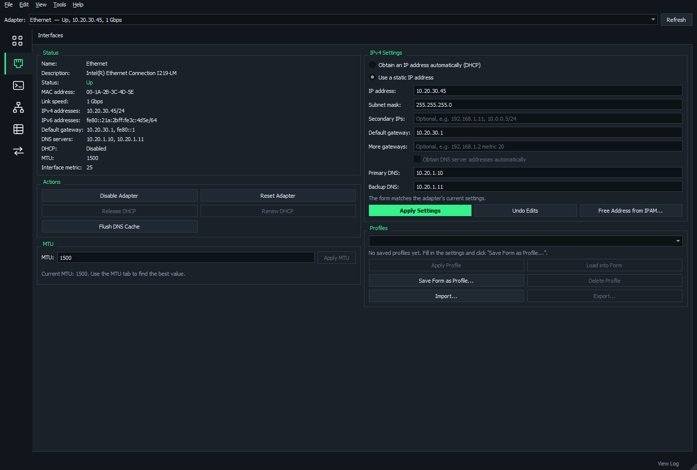
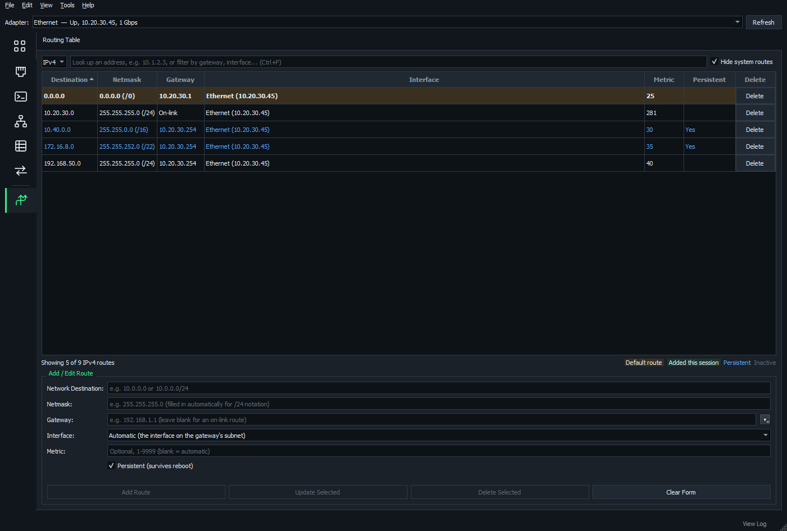
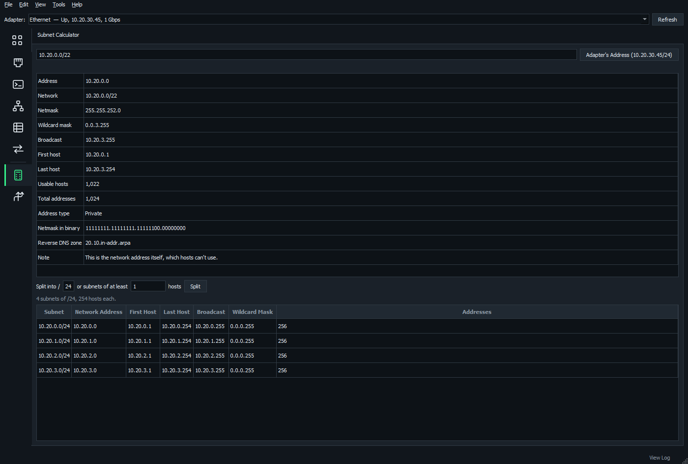

# All pages

What each page in NOMAD does, and how to get around them. The bigger pages have [their own guides](../README.md#guides).

**On this page**

- [Getting around](#getting-around)
- [This Computer](#this-computer)
- [Connect & Transfer](#connect--transfer)
- [Discover](#discover)
- [Diagnostics: Connectivity & Performance](#diagnostics-connectivity--performance)
- [Diagnostics: DNS & Web](#diagnostics-dns--web)
- [Network Management](#network-management)
- [Capture & Logs](#capture--logs)
- [Utilities](#utilities)
- [Other tools](#other-tools)

## Getting around

### Find a tool

- **Ctrl+K** opens tool search. Try "bandwidth" or "file transfer".
- The **favorites rail** on the left switches tools. Hover over an icon for its name. The selected tool is highlighted in green.
- The **Tools drawer** has the full list: favorites, recent tools and collapsible categories.
- **Ctrl+Tab** and **Ctrl+Shift+Tab** move between all tools.

### Set up the rail

- Right-click a tool to pin or unpin it.
- Drag favorites in the rail to reorder them. Favorites and their order are saved.
- Tools you used lately sit below a thin line, like the Windows taskbar, until other tools push them off.
- Right-click a recent tool to pin it or remove it, or drag it up among the favorites to pin it there.
- Right-click the rail > **Show Recent Tools Here** turns recent tools off.

### Tools drawer

The drawer closes when you choose a tool, click outside it or press Escape. To keep it open, choose **Keep drawer open**, **View** > **Keep Tool Drawer Open**, or press **Ctrl+B**. The preference is saved.

### Pop a tool out to its own window

Any tool except Terminal, SCP and RDP can move to a window of its own, for example to keep the Network Map on a second screen while you work in the main window. Terminal and SCP pop out single sessions instead (right-click the session's tab).

1. Open the tool, then click the pop-out button at the right end of its title, or press **Ctrl+Shift+Enter**. You can also right-click the tool in the rail or the drawer and choose **Pop Out to a Window**.
2. The tool moves to its own window, and the main window goes back to the tool you used before it. Anything the tool was doing, such as a ping or a crawl, carries on.
3. To put it back, close its window, click **Back to Main Window**, or press **Ctrl+Shift+Enter** in it.

A popped-out tool works the same as it does in the main window. Its window has the adapter picker, which is the same choice as the main window's, and a status bar for its messages. F5, Ctrl+F, Shift+Enter, Shift+Esc, Alt+A, F1 and the text size keys work there too, and F11 makes the window full screen. Links from other tools, such as **Ping** on a right-click menu, bring the tool's window to the front. Choosing the tool in the rail or the drawer does the same. Questions and dialogs the tool asks open over its own window.

Tools that are popped out when you close NOMAD open in their own windows again, in the same places, the next time it starts.

### Adapter and view

- Pick an **adapter** at the top of the window. Interfaces, MTU, Ping, Sweep, DHCP Servers and other pages work with it.
- **F11** (focus mode) hides everything but the current page.
- **View** > **Text Size** scales all text from 90% to 200%. **Ctrl+=**, **Ctrl+-** and **Ctrl+0** do the same.

## This Computer

### Interfaces

The adapter's status, addresses, gateway, DNS, speed and MAC.

- Switch between DHCP and a static IP. CIDR like `192.168.1.10/24` works.
- Add **Secondary IPs**, separated by commas, each with a /prefix or mask.
- Add **More gateways**, each with an optional metric. Windows prefers the lowest. The **Gateway** box takes a metric too (`192.168.1.1 metric 10`).
- Set DNS and MTU.
- Enable, disable, reset, release or renew.
- **Free Address from IPAM** fills in the next free address in a subnet you pick.
- Save settings as **profiles** to switch networks in one click.

### Routing Table

View, filter, add, edit and delete IPv4 and IPv6 routes, persistent ones included.

- Type an address in the filter to see which route Windows would use for it.
- **Persistent (survives reboot)** is ticked by default.
- The gateway's **▾** list offers the gateways this computer already uses, and sets the interface too.
- Adding a route through a gateway to a subnet this computer is already on warns you.

### ARP

Which MAC answers for each IP, with vendors. Warns about possible ARP spoofing and address conflicts.

### Connections

Every TCP connection and listening port with the program that owns it, like `netstat -ano`.

### Network Reset

Flush DNS, clear ARP, renew DHCP, reset Winsock and TCP/IP, and turn off a leftover proxy.

## Connect & Transfer

The [Terminal, SCP and RDP guide](terminal-scp.md) covers the first three.

| Page | What it does |
| --- | --- |
| **Terminal** | SSH, Telnet, serial and raw TCP sessions in tabs, tiles and pop-out windows |
| **SCP** | A WinSCP-style file manager for SSH servers |
| **RDP** | Saved Remote Desktop sessions in folders, with remembered credentials and display settings |
| **TFTP** | A TFTP server and client for firmware and config transfers. **Cisco TFTP Tips** shows how to make switches copy faster, with a bigger block size or SCP instead. |
| **Wake-on-LAN** | Wake a computer by its MAC, and save the ones you wake often |

## Discover

### Sweep

Finds every host on a subnet (ping, plus ARP on local subnets), with names, MACs and vendors. **Compare with IPAM** shows which hosts IPAM has, is missing or records with a different MAC.

### Switch Port

Which switch, port and VLAN you're plugged into, from LLDP and CDP.

### MAC Finder

Which switch and port a device is plugged into. Type its MAC address in any format (or part of one), its IP address or its name.

| Action | What it does |
| --- | --- |
| **Find** | Searches the Network Map's last crawl at once |
| **Locate Now** | Asks the map's switches over SNMP where it is now, following uplinks to the edge port. Wireless controllers are asked first, so a Wi-Fi client is found on its AP and SSID. |
| **Also over SSH** | Also asks switches at their command line (Cisco IOS, IOS XE and NX-OS show commands), following the MAC through CDP and LLDP onto switches the map doesn't have |
| **Start at switch** | Where to start with no map at all, or for a MAC the map doesn't know |
| **Trust new SSH keys** | Logs in to switches NOMAD hasn't connected to before. A switch whose key has changed is never logged into. |

- Paste or load a list to find many at once.
- See where each MAC has been in its history.
- The **Switches Asked** tab lists every switch a search asked, how it answered, and why any couldn't be asked. Right-click one to try its SSH login again or connect to it.

### DHCP Servers

Every DHCP server that answers, with each option it offers decoded, and warnings about rogue servers. Nothing is leased.

### SNMP Walk

Walk or get over SNMP v1, v2c or v3 (a user with authentication and privacy), with presets and a per-port interface summary.

## Diagnostics: Connectivity & Performance

| Page | What it does |
| --- | --- |
| **Ping** | Ping with a running summary, and quick buttons for the gateway and DNS server |
| **Latency** | Watches several hosts at once, with gauges, a graph over time (lost pings in red) and optional CSV logging |
| **MTU** | Finds the largest MTU that reaches a host without fragmenting, and applies it |
| **Ports** | Open, closed or filtered, for common port presets or any list and range |
| **iperf** | Bandwidth tests with a built-in iperf3-compatible client and server |

### Traceroute

Loss, latency and jitter for every hop, like MTR/WinMTR. Every hop is probed at once, so a trace takes seconds.

Like pathping, it separates real loss from a router that just doesn't answer pings:

- **Path loss** is the loss that carries on to the hops after each one, so real traffic is lost by there.
- The rest of a hop's **Loss** is its router skipping probes sent to itself, shown in gray.
- The **Note** says it in words: "Router skips 60% of probes; traffic passes it fine", "Loss starts here (20%)" or "10% more lost here".

**Copy Report** includes the Path% and Note columns.

## Diagnostics: DNS & Web

| Page | What it does |
| --- | --- |
| **DNS Lookup** | A, AAAA, MX, TXT and other records, from any DNS server |
| **DNS Servers** | Times how fast each DNS server answers, and checks reverse (PTR) records |
| **Web Check** | DNS, connect, TLS and first-byte timings, the certificate, and redirects |

## Network Management

| Page | What it does | Guide |
| --- | --- | --- |
| **Network Map** | Crawls switches, routers and firewalls over SNMP from a starting device and draws what's plugged into what, with the hosts on each port and the subnets and routes between them | [Network map](network-map.md) |
| **IP Addresses** | IP address management for several separate networks, shared through an IPAM server and usable offline | [IPAM and the tribe](ipam-and-tribe.md) |
| **VLANs** | Each VLAN domain's VLANs and the subnets they carry, brought in from what the map finds | [VLANs](vlans-subnets-assets.md#vlans) |
| **Subnet Placement** | Where each subnet is planned to be and where the map finds it, whether it's advertised, what's wrong, and moving subnets | [Subnet Placement](vlans-subnets-assets.md#subnet-placement) |
| **SNMP Config** | Builds the Cisco IOS / IOS-XE configuration that sets a switch up for NOMAD, and types it into a terminal session | [SNMP Config](snmp-config.md) |
| **ACLs & Route Maps** | Reads, builds and edits ACLs, prefix lists and route maps, finds entries that never match and changes that would lock you out, tests packets and routes, and sends changes with a revert timer | [ACLs and route maps](acls-route-maps.md) |
| **VPNs** | Builds and edits IPsec VTI, GRE over IPsec, GRE, crypto map and DMVPN VPNs between Cisco routers, checks the design, sends it with a revert timer, and says why one is down | [VPNs](vpns.md) |
| **Assets** | Every piece of hardware on the network, with hostname, model, serial number and software version kept together | [Assets](vlans-subnets-assets.md#assets) |
| **Ansible Inventory** | An Ansible inventory from the map's devices and your saved sessions | [Below](#ansible-inventory) |

### Ansible Inventory

Makes an Ansible inventory, in YAML or INI, from the Network Map's devices and your saved SSH sessions, ready to copy or save for a control node.

1. Tick the devices to include. **Network Devices**, **All Shown** and **None Shown** tick whatever the filter shows.
2. Check each device's **Ansible OS**. NOMAD works it out from what the map read. Where it can't tell or gets it wrong, select the devices and use **Set Ansible OS**.
3. Choose the groupings and options.
4. **Copy** or **Save As...**

**Supported:** Cisco IOS / IOS XE, NX-OS, IOS XR and ASA, Palo Alto PAN-OS, Juniper Junos, Arista EOS, Fortinet FortiOS, and Linux / Unix servers.

**Groups:** the map's sites, buildings and rooms (nested), kind (switches, routers, firewalls...), Ansible OS (each OS group holds its variables) and session folders. Each grouping can be turned off.

**Options:**

- `ansible_user` for everything (saved credentials' user names are offered)
- sessions' own user names
- short names without the domain
- enable mode (`ansible_become`) for IOS, ASA and EOS
- `nomad_*` variables (kind, model, location, folder) for playbooks

Good to know:

- A saved session of a device on the map joins it, matched by address or name, giving its user name and port. Sessions of other devices are listed on their own.
- The file starts with the `ansible-galaxy collection install` line for the collections it needs.
- Passwords are never written to it. Run with `--ask-pass`, or keep them in ansible-vault.
- Names Ansible would reject are made safe and unique.
- Anything worth knowing, such as a device with no address or an unknown OS, is listed under the inventory.

## Capture & Logs

| Page | What it does | Guide |
| --- | --- | --- |
| **Packet Capture** | Captures with Windows' built-in pktmon to a pcapng file, and looks through it (or any pcap/pcapng file): Wireshark-style filters, decoding, conversations, problems found, following a stream | [Packet capture](capture-mirroring.md#capture-packets) |
| **Port Mirroring** | Sets up SPAN, RSPAN or ERSPAN on Cisco IOS / IOS-XE switches in a click, checks the ports first, and takes it away again | [Port mirroring](capture-mirroring.md#mirror-a-port) |
| **Syslog** | Receives syslog from network devices, colored by severity and filterable | |

## Utilities

### Subnet Calculator

Network, mask, host range and counts for IPv4 and IPv6, and splitting a network into smaller subnets. The split table shows each subnet's network address, wildcard mask (IPv4) and number of addresses.

## Other tools

- **Diagnostics report:** **Tools** > **Run Diagnostics Report...** (Ctrl+R).
- **What's new:** **Help** > **What's New...** lists what each version added and fixed, newest first, with the version running marked.
- **Saved password protection:** **Tools** > **Saved Password Protection...** adds a master password.
- **Splash:** a splash says what NOMAD is loading while it starts.
