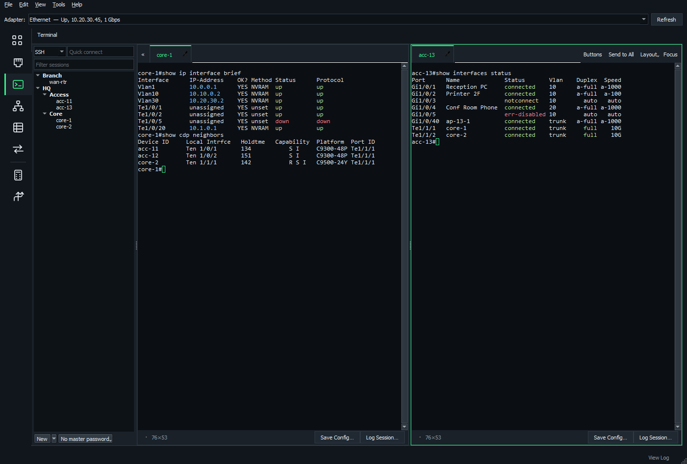

# Terminal, SCP and RDP

Everything for talking to devices and servers, sharing the same saved sessions and credentials.

**On this page**

- [Sessions](#sessions)
- [Saved credentials](#saved-credentials)
- [Work with many devices](#work-with-many-devices)
- [Stay connected](#stay-connected)
- [Save a device's config](#save-a-devices-config)
- [Security](#security)
- [Serial](#serial)
- [Keys](#keys)
- [Import, export and backup](#import-export-and-backup)
- [SCP](#scp)
- [RDP](#rdp)

## Sessions

- **Sessions** are saved in folders. Import them from PuTTY or a SecureCRT export.
- **Quick connect** takes `admin@10.0.0.1`, `telnet 10.0.0.5`, `raw 10.0.0.9:9100` or `COM3:115200`.
- **Recent** at the top of the list keeps your last 10 connections.
- **Layout** tiles sessions side by side, stacked, or in a 2 × 2 or 3 × 2 grid. Drag tabs between panes and windows.
- **Pop out** any tab into its own window (right-click the tab).

**Copy and paste** work as in PuTTY:

| Action | Result |
| --- | --- |
| Drag over text | Copies it |
| Double-click | Copies a word |
| Triple-click, or a click straight after a double-click | Copies the whole line |
| Right-click | Pastes |

## Saved credentials

Save a user name and password (or SSH key) once under a name, such as TACACS or Domain Admin, then choose it in SSH, SCP and RDP sessions instead of typing the login again.

- **Tools** > **Saved Credentials...** adds, edits and deletes them from any page.
- **Credential** sits at the top of the session editor's SSH section and above Username in the RDP editor. **Typed for this session** goes back to the session's own login.
- Mark one **Use for New Sessions** and every new SSH or RDP session starts with it. The first one you make is marked automatically.
- Changing a credential, such as after a password change, updates every session using it.
- Deleting a credential leaves its sessions with its user name and password as their own.
- Right-click a session for **Credential**, or select several for **Use Credential**.

An SSH connection with no user name (quick connect, or **Connect** > **SSH** on a host with no saved session) asks which saved credential to use, starting on the default. You can also type a user name instead. **Recent** reopens it the same way.

Credentials are encrypted like saved passwords, and travel in NOMAD backups.

## Work with many devices

- **Send to All** sends a command (or Ctrl+C, Ctrl+Z, Ctrl+Shift+6...) to every session.
- **Type in All** mirrors your typing.
- **Command buttons** send saved commands or blocks of configuration with one click, or with Ctrl+1 to Ctrl+9 (even with the Buttons bar hidden). To change a button's order and hotkey, drag it, or right-click it > Move to Position.
- **Keyword highlighting** colors down, err-disabled, % Invalid, up, and IP and MAC addresses. Change the rules in **View** > **Terminal Keyword Highlighting...**

## Stay connected

- **Line delay** (per session) keeps slow consoles from dropping pasted text.
- **Reconnect automatically** when a device reloads.
- **Anti-idle** keystrokes keep exec-timeout from logging you out.
- **Log Session...**, beside Save Config..., saves a plain-text session log. The button changes to **Stop Logging** while recording, and **Ctrl+S** does the same.
- The saved session's **Logging** option starts logging automatically in its folder when you connect.

## Save a device's config

**Save Config...** saves the complete running configuration to your workstation as a timestamped `.cfg` file, or a name you choose.

1. Start at the device's exec prompt, with permission to read the full config.
2. Click **Save Config...** (or press **Ctrl+Shift+S**, or right-click the session tab).
3. Pick Cisco IOS / IOS XE / NX-OS / Arista EOS, Cisco ASA, Juniper Junos, or a custom command.
4. Choose where to save.

Good to know:

- Cisco profiles turn off paging for the session, and Junos uses `no-more`. Turn off paging yourself before a custom command.
- Capture is independent of scrollback and finishes when the device prompt returns.
- **Cancel Save** (or Ctrl+Shift+S again) interrupts it.
- A disconnect, command error or five-minute timeout leaves the destination unchanged.
- It stays in that session even with Send to All on.

## Security

- SSH logs in with a password, an OpenSSH private key, or Pageant/SSH agent.
- Saved passwords are encrypted for your Windows account (DPAPI). Add a **master password** (AES-256) for more protection.
- Host keys are remembered, and NOMAD warns if one changes.
- Older switches that only speak SHA-1 SSH algorithms still connect.

## Serial

Serial sessions list the COM ports present, and can send a break (for Cisco ROMMON).

## Keys

- **Ctrl+Shift+F** finds text, **Shift+PgUp** scrolls back, and **Ctrl+mouse wheel** zooms.
- Keys like Ctrl+B and F5 go to the device, not to NOMAD. So do **Ctrl+W** (nano's Where Is, the shell's delete-word), **Ctrl+L**, **Ctrl+C** and **Ctrl+R**.
- Close a terminal session with its tab's close button.

See the [keyboard guide](keyboard-shortcuts.md) for the rest.

## Import, export and backup

**File** > **Export SSH Sessions to SecureCRT...** writes an XML file for SecureCRT's **Tools** > **Import Settings from XML File**.

- It includes folders, hosts, ports, usernames, notes, private key paths and saved SSH passwords.
- When passwords are present, unlock NOMAD if needed, then enter and confirm the destination SecureCRT configuration passphrase.
- Passwords are encrypted in SecureCRT's salted `03:` format, so the destination must use the same passphrase before importing.
- It doesn't change SecureCRT's global security settings.
- Private key contents and saved key passphrases are excluded.

**File** > **Export / Import NOMAD Terminal Settings and Sessions...** saves or restores a password-protected `.nomad` backup.

- It includes all saved sessions and credentials, RDP sessions, empty folders, recent connections, command buttons, highlighting, Terminal/SCP preferences and text scale.
- Import replaces these settings after confirmation, and protects credentials with the destination's Windows account and current master password.
- Keep the backup password to restore on another computer.
- Private keys and logs stay as external files. Live connections aren't part of the backup.

## SCP

A WinSCP-style file manager using the same saved sessions.

| Key | Action |
| --- | --- |
| Drag, or F5 | Copy between your computer and the server |
| F4 | Edit a remote file in place |
| F2 | Rename |
| F7 | Make a folder |
| F8 | Delete |

- **Permissions:** change permissions and owners (chmod and chown).
- **Work as Root** (sudo) browses, copies and edits as root.
- **Transfers** queue with progress, can be paused and resumed, and can be checked with SHA-256.
- **Synchronize** compares a local and a remote folder and copies the differences.

## RDP

The **RDP** page keeps saved Remote Desktop sessions and launches Windows' built-in Remote Desktop Connection. It has its own session folders, and uses NOMAD's shared password vault.

### Create a session

Give it a computer name or IP address, port and username (`DOMAIN\user` or `user@domain`), and optionally remember its password.

### Launch

- Double-click a session or click **Launch**.
- **Quick connect** accepts `host`, `host:3390` or `[IPv6]:3389`. With saved credentials, it asks which one to log in with, the default first.
- Recent launches can be saved as sessions.

The full-width list shows addresses, usernames, password status, display mode and last launch.

### Display options

Full screen, window size and all monitors, plus clipboard, audio and administrative sessions. Windows policies may still require interactive sign-in.

### How passwords are handled

- NOMAD hands passwords to the client in an encrypted temporary `.rdp` file, normally deleted after one minute.
- Files left by an interrupted launch expire after 24 hours, and are cleaned up next time the RDP page starts or launches a connection.
- Closing NOMAD leaves Remote Desktop windows running.
- Encrypted NOMAD backups include RDP sessions, credentials and page preferences.
