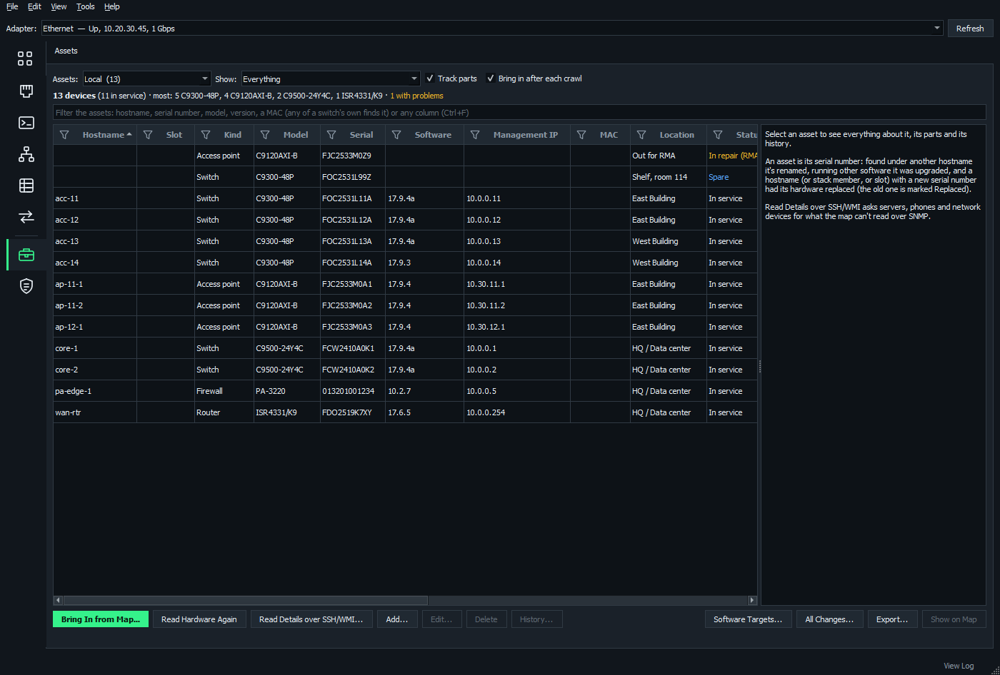

# VLANs, subnets and assets

These Network Management pages sit beside [IP Addresses](ipam-and-tribe.md) and work with the [Network Map](network-map.md).

**On this page**

- [VLANs](#vlans)
- [VLANs on the map](#vlans-on-the-map)
- [Carry VLAN](#carry-vlan)
- [Subnet Placement](#subnet-placement)
- [Assets](#assets)
- [The pages and the map together](#the-pages-and-the-map-together)

## VLANs

The **VLANs** page keeps each VLAN domain's VLANs: number, name, status (active, reserved or planned), description and the subnets each carries.

### Domains

A domain is where VLAN numbers are unique: a VTP domain, or a site's switches.

- **New Domain** makes a Tribe one (shared through the IPAM server) or a Local one.
- A domain can belong to one IPAM network, whose subnets its VLANs carry.
- A domain can have ranges set aside (100-199 for users, say), which **Next Free** picks from.

### IPAM stays as it is

A VLAN names its subnets by CIDR, in its domain's network. Nothing is written to the subnets, so the IP Addresses page and its workbook export don't change.

**Domain** > **Link Subnets Named for VLANs** links subnets whose names (Vlan 6) or details (a Vlan 10 column) say which VLAN they're in, without touching them.

### Bring VLANs in from the map

**Domain** > **Bring in VLANs from a Network Map**, or **Add to VLAN Database** on the map's VLANs tab, compares what the crawl found with a domain, or a new one named after the VTP domain. You tick what to add, rename or link.

- Each VLAN interface (an SVI, or a router's subinterface such as Gi0/0.100) links the IPAM subnet holding its address.
- The network holding most of them is suggested for a domain that has none.
- VLANs deleted from the domain, and names it already has, aren't ticked. The database may have the intended answer, and the switches may be what needs changing.

### On the page

- **Gateways (IPAM)** comes from the linked subnets.
- **VLAN Interfaces (Map)** comes from the open map.
- **On the Map** says how many switches have each VLAN, warning when a switch names it differently.
- In a VLAN's window, the subnets holding its interfaces on the map are marked and listed first.
- **Highlight on Map** shows a VLAN on the map.
- **Show Subnet in IPAM** goes to its subnet.
- **History** shows who changed it and when.

### Offline

Tribe VLANs can be changed offline. Changes wait as pending and are sent when the server is back.

**Review Refused VLAN Changes** offers the next free number (in the same range) or discarding, for a VLAN someone else changed first. Domains can only be changed online.

The server needs NOMAD 1.16 or later (**Update Service** in Tribe Management).

## VLANs on the map

The crawl reads every switch's VLANs, VTP domain and port VLANs (access, voice, trunk native and allowed).

The map's **VLANs** tab lists each VLAN by VTP domain with its switches, ports, gateways and hosts, and **checks** for mistakes:

- a trunk facing an access port
- native VLANs that differ
- VLANs allowed at one end of a trunk only
- access ports in VLANs the switch doesn't have
- a VLAN named differently on two switches

**Highlight on Map** (or right-click a device > **VLANs** > **Highlight VLAN**, or a port > **Highlight VLAN**) fades everything that doesn't carry the VLAN. Links that do are colored by how they carry it, and a trunk allowing it at one end only is dashed orange. **Stop Highlighting VLAN** is at the top of every right-click menu while one is highlighted.

VLANs stay up to date as the map does. Mapping again, **Crawl from Here** and watching all read them again. Watching reads each switch every hour, and when a trap, syslog message or new neighbor says something changed. Its log notes VLANs added, gone or renamed, and ports moved to another VLAN.

**Read VLANs Again** on the VLANs tab reads just the VLANs, quickly. It's how a map made before NOMAD read VLANs gets them.

## Carry VLAN

**Carry VLAN** gets a VLAN to a switch over the map's links, on Cisco IOS / IOS-XE switches. Start it from:

- a switch > **VLANs** > **Carry a VLAN Here...** (or a port's hosts > **Carry a VLAN Here...**)
- two selected devices > **VLANs** > **Carry a VLAN Between These...**
- a VLAN on the VLANs tab > **Carry It to a Switch...**

### Choose the way

NOMAD starts from the nearest switch already carrying the VLAN (the part with its gateway first), or from A if you choose one, and takes the way needing the fewest changes. After Plan, the switches chosen are listed with each link.

Or choose **Through these switches** and set the whole route yourself:

- **Add Switch...**, or **Pick on Map** and click them in order
- where two switches have several links, choose the one to use
- **Fill In Between** adds the switches between two that aren't linked
- **Edit This Route** turns the way NOMAD chose into one you can change

Routers and firewalls can only be where it starts (a router-on-a-stick's subinterface counts). A link with an access port in another VLAN is never used or changed.

### Plan

**Plan** reads the switches involved again (their VLANs, port-channels, and how spanning tree has their ports for the VLAN), then lists each switch's changes:

- the VLAN created where it's missing (on a VTP client, on its domain's VTP server, which goes first)
- `switchport trunk allowed vlan add` on each trunk end that doesn't allow it, always with `add`, so nothing else on the trunk is touched
- port-channels are changed, never their members
- any of B's edge ports you tick

Problems are listed above: no VTP server on the map, an extended VLAN on VTP version 1 or 2, a port spanning tree blocks in an MST instance, a switch that wasn't read.

### Redundant links

Links that would close a loop once the VLAN is on the way are listed with what spanning tree does there:

- Rapid-PVST+ keeps one blocked for the VLAN.
- MST blocks by instance, so you're warned.
- An unknown spanning tree could loop.

They're only changed when you tick them, and they go last.

### Gateway

Whether B will reach the VLAN's gateway (an SVI or a subinterface on the map) is checked, never set up.

### Send

- **Send** on each switch's row types into a connected terminal session, or **Open Session to** the switch (its saved SSH session, else its saved Telnet one), a line at a time after you say yes, at the enable prompt.
- **Send All over SSH** sends each switch its lines in order, stopping at the first that refuses them.
- **Send Undo**, or **Undo Sent over SSH**, takes it back out.
- **Copy** and **Export All...** give you every switch's configuration and undo.
- **write memory** is only added if you tick it.

### Verify

**Verify** reads the switches again and marks each one done, or says what isn't yet (a VTP client still waiting for the VLAN, say), along with any VLAN mistakes now on the route's links.

While the window is open, the map highlights the VLAN and rings the route's switches: amber for the ones to change, green for the rest. Hover over a link for what changes there.

| Line on the map | Meaning |
| --- | --- |
| Thick green dashed | The VLAN will be added |
| Thick green | Carried already, or verified |
| Thick amber dashed | A redundant link, ticked |
| Amber dotted | A redundant link, not ticked |
| Red dashed | A link that can't carry it |

## Subnet Placement

An *advertised* subnet (one other routers have a route to) can be in only one place at a time. A *local* one (nobody routes to it, such as a printer subnet reused at every site) can be in several.

**Subnet Placement** checks this for an IPAM network against the map open on the Network Map page.

### Each subnet shows

Per VRF:

- **Where it's planned:** the VLANs it's linked to on the VLANs page.
- **Where the map finds it:** each device's address in it. Places that are one L2 segment count as one: HSRP/VRRP SVIs on a trunked VLAN, a link's two ends, a router subinterface and the switch it's on, or two linked devices whose link can carry it.
- **Whether it's advertised:** the protocols and how many routers have a route to it, each route followed to where it leads, so each place says whether that device advertises it or only has an address in it.

Routers on it the map couldn't read are noted. A subnet only covered by a summary counts as local, with the summary noted.

### What's wrong

- an advertised subnet in two places
- routers reaching it in different places
- an advertised subnet linked to two VLANs
- a subnet in another VLAN on the map than it's linked to
- a local-only subnet leaking into the routing tables
- an advertised subnet inside another one advertised elsewhere

**Show** picks problems, advertised, local, moving, or subnets on the map that aren't in the network.

### Roles

Not every subnet is in a VLAN, so each has a role saying what it's for:

**VLAN**, **Point-to-point**, **Loopbacks**, **Tunnel**, **Routed port**, **Container** (a block holding other subnets) or **Other** (not known yet: nothing is expected of it).

- It's worked out from the map, then IPAM, then the VLANs page, and shown in the **Role** column with a filter.
- A tunnel's ends, or a point-to-point link's, count as one place however far apart they are. So a DMVPN subnet advertised from the hub and every spoke isn't "in several places".
- Router loopbacks inside IPAM's loopback subnet belong to it, and one loopback address on two devices is a problem.
- Only VLAN subnets are expected to be linked to a VLAN. The VLANs page's subnet list and name-based suggestions leave the others out (a tick box lists them too).

**Role and Scope** sets what a subnet is for, sets advertised or local when the routing tables don't say it right (with a note), or marks its places one L2 segment the map can't see.

A role that doesn't fit the map is pointed out. It's kept beside the VLANs, shared with the tribe, never on the IPAM subnet, so exports are unchanged.

### Move a subnet

1. **Plan Move:** from its VLAN and device to another, when and why.
2. **Start Move** when the work begins.
3. **Read Routes Again** once it's done on the switches.
4. **Check Move:** it's only at the new place, and every route leads there.
5. **Complete Move** relinks it on the VLANs page.

While it's in progress, the page expects it at the old place or the new one, and flags it if it's advertised from both.

### VRFs

Each VRF is checked on its own, so the same subnet in two VRFs is two subnets.

Interfaces' VRFs come from CISCO-VRF-MIB or MPLS-L3VPN-STD-MIB, and VRF routing tables from MPLS-L3VPN-STD-MIB. When a device doesn't offer those, the crawl log says so and the page notes it.

Watching notes subnets that appear, go or move between switches in the Watch log. **Read Routes Again** brings the map's routing tables up to date without mapping again.

## Assets

The **Assets** page is the inventory of the hardware on the network. Each asset is its **serial number**: its hostname, address and software version are what it has now, and its history says what they were.

### From the map

Every crawl reads each device's hardware over SNMP (ENTITY-MIB):

- one chassis per stack member, with model and serial number
- modules, power supplies, fans and transceivers with a serial number
- the **software version**, from its system description or PAN-OS's and FortiOS's own MIB

An Aruba wireless controller gives its own details and those of all its access points, up or down. Phones tell their switch their model and firmware (CDP) and serial number (LLDP-MED).

The map's device details and Devices table show the serial and software too.

### Kept in step by itself

With **Bring in after each crawl** ticked (the default), each crawl, Crawl from Here and Read Hardware Again brings what it found into the list:

- New hardware is added.
- A device under another hostname, or running other software, is changed. Renames and upgrades go in its history.
- Where a hostname, stack member or slot now has a **different serial number**, the old hardware is marked **Replaced**, pointing at the new one. The new one keeps its location and owner, not its asset tag.

Some things wait for you:

- Changes that might undo what was said by hand wait for **Review the Crawl's Hardware**.
- A serial number found on two devices (lab images often share one) is pointed out, never brought in.

**Bring In from Map...** does the same with a review first, for the open map or a map file.

**Read Hardware Again** (on this page, or right-click devices on the map > **Tools**) reads just hardware and software. It's how a map made before NOMAD read serial numbers gets them, and how a swapped part shows up without mapping again.

### Parts

**Track parts** (ticked by default) brings modules, power supplies, fans and transceivers in as their own assets, in the chassis they're in. Untick it to keep just chassis, phones and servers.

### MAC addresses

- A phone's or server's MAC is recorded with it.
- Each switch's and router's **base MAC** is too: the first of the block burned into its chassis, which stays with the hardware like its serial number.
- A stack's members each have their own (CISCO-STACKWISE-MIB).
- A device on its own gives it as its LLDP chassis ID or bridge address. A firewall that gives neither gives its management interface's MAC, and its details say so.
- A stack's own MAC isn't put on any member, because it moves with the active member.

Type a whole MAC in the filter box, written any usual way (`00-1B-17-00-01-00`, `00:1b:17:00:01:00`, `001b.1700.0100`), to find what it belongs to: a phone's or server's own, a chassis' base MAC, or, by the open map, one of its ports' or VLAN interfaces' MACs. So a MAC from MAC Finder or an ARP table leads to the switch.

### Without a serial number

- A phone, or a chassis giving no serial, is known by its MAC until its serial number is known.
- A device NOMAD can't read (seen only in a neighbor's CDP) is known by the map device it is.
- A Nexus switch's CDP name carries its serial number, which is used.

### Read details over SSH or WMI

For servers, phones, and devices SNMP says nothing of, **Read Details over SSH/WMI...** asks:

| Device | How |
| --- | --- |
| Windows servers | WMI over WinRM or DCOM, as your Windows login or a user name and password (which goes to PowerShell on its input, never its command line) |
| Linux servers | SSH: a saved session, a saved credential or a typed login. The serial number needs root, so passwordless sudo is tried. |
| Cisco IP phones | Their web page |
| Cisco switches, routers and firewalls (IOS, IOS XE, NX-OS, ASA) | SSH: **show inventory** and **show version**. Nothing is changed. |

It shows what that changes before recording it. A network device on the open map gets the hardware on the map too, and keeps it when a later crawl's SNMP says nothing of it.

On the map, right-click devices > **Tools** > **Read Hardware over SSH...** This works for ones that don't answer SNMP at all. **Read Hardware Again** names the devices whose SNMP gave no serial numbers.

### By hand

- **Add...** records hardware the map can't see, such as a spare on the shelf.
- **Edit...** has every field: asset tag, owner, location, status (In service, Spare, In repair (RMA), Replaced, Retired), purchase, warranty and end-of-life dates, notes.
- Right-click several to set their status, location or owner at once.

### Software targets

**Software Targets...** keeps the software each model should run: a target version, and other versions that are fine too.

- A target can be for one model (`C9300-48P`) or a family (`C9300-*`, `CP-88??`). The most exact one counts.
- **Add from the Asset List...** starts one for each model from the version most of it runs.
- Right-click a device > **Make 17.9.4a the Target for C9300-48P...** sets one from it.

Each device is then on target, **behind**, **ahead**, or running **other software** (another train, such as 15.2(7)M against 15.2(7)E). Versions compare the way their numbers read: 17.9.4a is ahead of 17.9.4 and behind 17.12.1.

- The Software column is colored by it.
- **Show** > Not on target software lists the ones off it, and the summary counts them.
- The export has each one's target.
- On the map, **Overlay** > **Software Targets** colors the devices the same way.

The tribe's targets are shared through the IPAM server, and change only while it can be reached. The server needs to be on the same version of NOMAD (**Update Service**).

### Problems

The **Problems** column (and **Show** > With problems) points out:

- assets with no serial number
- hardware in service not on a map for 30 days
- a device off its model's software target (or, for a model without one, running other software than most of its model)
- an ended warranty or end of life

### History and export

- **History...** shows one asset's changes, and **All Changes...** every asset's.
- **Export...** writes the list to Excel or CSV.
- **Show on Map**, and the map's right-click **Show In** > **Assets**, go between an asset and its device.

### Shared and offline

Like VLANs, the tribe's asset list is shared through the IPAM server and can be changed offline. Changes wait until the server is back. **Review Refused Asset Changes** lists any someone else beat, because they changed that asset first or recorded its serial number. The server needs to be on the same version of NOMAD (**Update Service**). Local is this computer's own list.

## The pages and the map together

- **One network at a time:** choosing a network on IP Addresses, VLANs (a domain of it) or Subnet Placement chooses it on the others. Opening a map of a network chooses that network.
- **A map is of one IPAM network:** **IPAM Network...** (on the map's bar or Map menu) says which, suggesting the one holding most of the map's subnets. It's saved with the map and shared with a tribe map, so [use a tribe network for a tribe map](ipam-and-tribe.md#use-a-tribe-network-for-a-tribe-map). VLANs and Subnet Placement only check a network against a map of it.

### When a network has no map or VLAN domain

- The Network Map page says so in a bar: a map not tied to an IPAM network (with **IPAM Network...**), or a map of another network, with **Open** for that network's map and **Back to** the map's network.
- A tribe map no one has tied to a network asks once, when opened.
- The VLANs page shows nothing for a network with no VLAN domain, with **New Domain for** it.

### IPAM on the map

- The Hosts tab has an **IPAM** column: in IPAM with its name, not in IPAM, or IPAM has another MAC address.
- The logical view's subnets show their IPAM name and role, outlined orange or red when Subnet Placement finds something wrong, and say "not in IPAM" when the network doesn't have them.
- Watching notes new hosts and subnets the network doesn't have in the Watch log.

### Record what the map found

**Record in IPAM...** (on the map's bar and Map menu, a device's right-click, or the Hosts tab's right-click) lists addresses IPAM lacks, or has with another MAC:

- a device's management address, named after it (R1S1)
- an interface's, after the device and port (R1S1 Vl100)
- a host, by its name

Tick what to record, rename any first, then click **Record Ticked**. Nothing is written before that. Tribe networks take them offline too. The map must be tied to its IPAM network first.

### What IP Addresses shows

The **On Map** column on the IP Addresses page shows where the open map has each address.

On the selected subnet's line above the addresses, it shows the subnet's role, its linked VLANs, whether Subnet Placement finds anything wrong, and how many places the map has it in, each a link to that page. None of it is written to IPAM, so exports are unchanged.

### Links everywhere

| From | You can reach |
| --- | --- |
| A subnet's right-click (IP Addresses) | Its VLANs, its placement, it on the map |
| An address's right-click | The device that has it, or the switch a host with it is on |
| VLANs page | Each subnet's role and placement, and **Show Subnet in Subnet Placement** |
| Subnet Placement | IP Addresses, VLANs and the map; right-click shows its VLANs |
| A subnet on the logical view | The other pages |
| A device on the map | Its addresses in IP Addresses, its subnets in Subnet Placement |
| A port on the map | Its VLANs, its host's address in IP Addresses |
| The map's VLANs tab | **Show on VLANs Page** |
