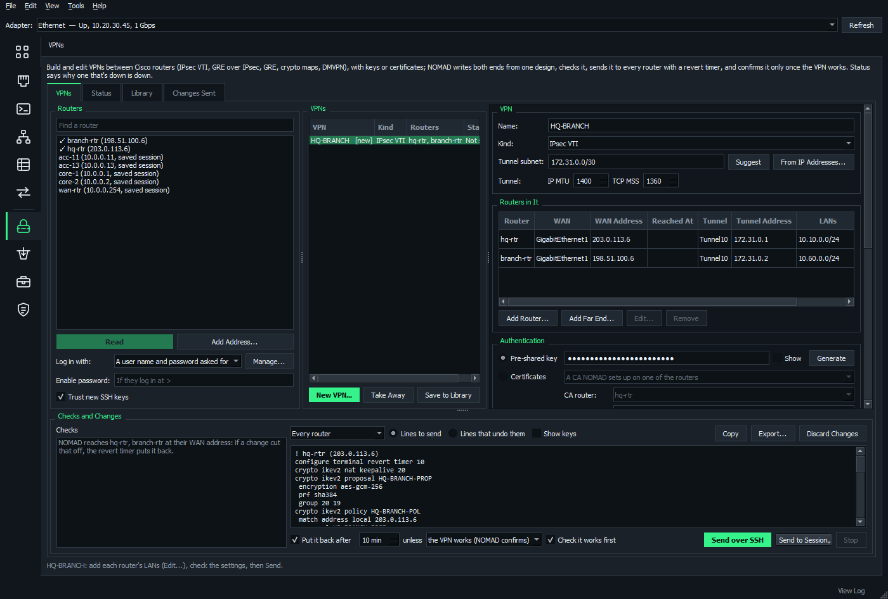

# VPNs

The **VPNs** page (under Network Management) builds and edits VPNs between Cisco IOS / IOS-XE routers, writing every router's side from one design. It also says why a VPN that isn't up isn't.

**On this page**

- [Kinds of VPN](#kinds-of-vpn)
- [Read what's there](#read-whats-there)
- [Build a VPN](#build-a-vpn)
- [One side only](#one-side-only)
- [Templates](#templates)
- [Edit or remove a VPN](#edit-or-remove-a-vpn)
- [Checks](#checks)
- [Send it](#send-it)
- [Certificates](#certificates)
- [Status](#status)
- [Library and history](#library-and-history)

## Kinds of VPN

| Kind | Use it for |
| --- | --- |
| **IPsec VTI** | A routed IPsec tunnel interface: the usual choice for site to site |
| **GRE over IPsec** | Carrying multicast and other protocols (IPsec in transport mode) |
| **GRE** | A plain tunnel, not encrypted |
| **Crypto Map** | Policy-based IPsec on the WAN interface between the two routers' LANs, for a far end that only does that (IKEv1 or IKEv2) |
| **DMVPN** | Hubs and spokes on one multipoint GRE tunnel, with NHRP and IPsec |

DMVPN comes as phase 1 (hub and spoke), phase 2 and phase 3 (spokes build tunnels to each other as needed; phase 3 with NHRP redirect and shortcut), with one hub or two. A second cloud (two hubs' WAN links, or a dual-homed hub) is a second DMVPN: spokes with two multipoint tunnels on one WAN interface get tunnel keys.

## Read what's there

1. Pick routers on the left: the open Network Map's routers and switches, saved SSH sessions, or **Add Address...**
2. Click **Read**.

NOMAD reads each one's running-config, routes, the log, and `show crypto session detail`, `show crypto ikev2 sa` / `isakmp sa`, `show dmvpn` and `show crypto pki certificates`.

It finds the VPNs on them, built by NOMAD or by hand:

- tunnels paired by their addresses
- DMVPN clouds by NHRP network ID and tunnel subnet (hubs are the routers the others register with)
- crypto map entries by peer address

A VPN whose far end wasn't read shows that end as an address. Its own side can still be changed.

**From the map:** right-click a router > **Tools** > **VPNs...**, or select two routers (or more, for a DMVPN) > **Tools** > **Build VPN Between...**

## Build a VPN

Click **New VPN...** and give a name, the kind and the routers, with each one's role in a DMVPN.

### What NOMAD fills in

- each router's WAN interface (the one toward the others)
- a tunnel number free on all of them
- a tunnel subnet in 172.31.0.0/16 that none of them uses (**Suggest**, or **From IP Addresses...** to take a free block from a subnet there and record it)
- the tunnel addresses
- a random 24-character key

### What you add

- each router's **LANs** (Edit..., or picked from its interfaces)
- **Reached At**, for a router behind NAT. The others use that address, and its own stays its IKE identity.

### Authentication

A pre-shared key (**Generate**, **Show**) or [certificates](#certificates).

### Crypto

| Choice | Settings |
| --- | --- |
| **Modern IKEv2** | AES-GCM-256, DH 20/19 |
| **Compatible IKEv2** | AES-256 with SHA-256, DH 14 |
| **IKEv1** | For older peers |
| Your own | Encryption, integrity or PRF, DH groups, the IPsec transform, PFS, DPD, NAT keepalives |

### Routing across it

Static routes, EIGRP (classic or named), OSPF or BGP, set up the way each kind needs:

- on a DMVPN hub, no split horizon, and no next-hop-self for phase 2
- OSPF point-to-multipoint, or broadcast with spokes at priority 0 for phase 2
- a BGP listen range and peer group on the hub

With BGP, **Keep the VPN's LANs from the routers' other BGP neighbors** (on by default) adds the VPN's LANs as denies to their outbound prefix list, or puts NOMAD's guard list on them, so an ISP is never told them.

Tunnels get IP MTU 1400 and TCP MSS 1360.

## One side only

For a far end you can't reach or don't manage, tick just one router in **New VPN...** and type the far end's WAN address. For a DMVPN, tick only spokes and type the hub's address, or tick only a hub. You can also use **Add Far End...** in the editor.

- Give the far end its tunnel address, LANs and BGP AS (Edit...) so the other routers' lines are right.
- NOMAD sends nothing to it.
- Its lines are under Changes as "(by hand)" to copy, export or type into a terminal session, with placeholders such as `<WAN-INTERFACE>` for what isn't known.
- **Check it works first** only passes once its side is in. Untick it to send your side alone.

## Templates

**New VPN...** > **Template: no routers** (with **Hubs** for a DMVPN) makes a VPN with no routers: sides A and B, or the hub(s) and a spoke that stands for every spoke.

- Choose its settings as for any VPN.
- Each side's lines have placeholders (`<A-WAN-INTERFACE>`, `<SPOKE-WAN-IP>`, `<SPOKE-TUNNEL-IP>`, `<HUB-LAN-NETWORK>`, `<B-AS>`...) with a legend of what each one stands for.
- A side's details can be typed in place of a placeholder (Edit...).
- The lines suit classic IOS as well as IOS XE (they keep the NHRP lines XE takes as defaults).
- **Save to Library** keeps a template. **Use** builds it on routers, or makes another template from it.

## Edit or remove a VPN

Edit a VPN found on the routers the same way. Only what changed is sent, in an order IOS takes:

- What something uses goes in first.
- Anything still in use is taken off what uses it before it's removed. For example, a crypto map comes off its interface before its entry goes, and far ends' sessions are cleared before an IKE profile goes.
- The names each router uses (its proposal, keyring, profiles, crypto map...) are kept.
- Lines NOMAD doesn't know are left as they are.
- Objects other VPNs use too are shared.
- A crypto map VPN on a WAN interface that already has a crypto map gets an entry in that map.

**Take Away** removes a VPN from its routers. What other VPNs may share, such as NAT keepalives and an IKEv1 policy, stays.

## Checks

NOMAD looks for what would stop it working or make it unsafe:

- recursive routing: a far end's address inside what goes over the VPN
- a LAN covering the WAN network
- a far LAN the router already reaches with a better route, so it would keep going that way in the clear
- LANs a routing protocol won't advertise
- other eBGP neighbors a VPN's routes would leak to
- a router's NAT catching the traffic before its crypto map
- an ACL on a WAN interface dropping IKE, NAT-T, ESP or GRE from the far end
- overlapping addresses and tunnel numbers taken
- keys that are short or have characters IOS chokes on
- weak crypto, MTU and MSS
- certificates missing, or a clock not kept by NTP
- this PC being inside a LAN the VPN carries

## Send it

**Changes** shows each router's lines (or **Every router**) and what undoes them. Keys stay hidden unless **Show keys** is ticked.

**Send over SSH** puts the change on every router with the revert timer (**Put it back after**, 10 minutes by default), spokes before hubs. NOMAD sets an archive path where there's none.

With **Check it works first**, NOMAD then checks the VPN from each end:

1. The far tunnel addresses answer.
2. The LANs reach each other, so the routing works.
3. The crypto sessions are up.

Only then does it confirm the change on every router from new logins. Or, with **unless I click Confirm All**, it waits with a countdown for **Confirm All** or **Put All Back Now**.

If any router refuses a line, or any check fails, every router is put back (`configure revert now`), and NOMAD says why.

After a confirmed change to the crypto of a VPN that was up, **Clear Sessions Now...** offers `clear crypto session remote ...`, so the new settings take effect straight away.

**Send to Session** types a router's lines into a terminal session instead.

## Certificates

Three ways to get them:

- from a **CA NOMAD sets up on one of the routers**: an IOS certificate server granting automatically, reached over SCEP, with HTTP open only to the VPN's routers
- from a **CA's SCEP URL**
- **by hand**: paste the CA's certificate, have each router make its request to take to the CA, and paste back what it signs

**Get Certificates** does what's needed before Send:

1. If a router's clock isn't kept by NTP (IOS won't use certificates then), it makes the CA router the VPN's time source (`ntp master`), points the others at it and waits for the clocks. This takes a few minutes.
2. It sets up the CA.
3. It enrolls each router without a certificate in the trustpoint, trusting the CA only if it shows the expected fingerprint.

The routers then authenticate with RSA signatures, matching each other's certificates by issuer.

## Status

Each VPN found is shown as up, partly up or down, and why:

- a tunnel down
- no IKE answer from a peer: UDP 500/4500 blocked, wrong address, no profile for it
- IKEv1 stuck at MM_NO_STATE or MM_KEY_EXCH (most often a key mismatch)
- IKEv2 stuck negotiating
- IKE up but no IPsec: transform sets or crypto ACLs that don't match
- packets sent but none back
- a spoke not registered with its hub
- spoke-to-spoke tunnels up now
- certificates expired or not yet valid
- what the routers logged about it, in words

Use **Read Again** (or **Every minute**) and **Clear Sessions...**.

**On the map:** **Overlay** > **VPN Tunnels** draws tunnels between the map's routers as dashed lines: green up, amber partly up, red down. It shows the ones the crawl found and the VPNs read here, which update the map as soon as they're read. See [Tunnels](network-map.md#tunnels).

## Library and history

- **Library** keeps designs, without their keys, to build again on other routers.
- **Changes Sent** keeps every change, with the keys protected for this Windows account: **Undo over SSH**, **Undo in Session**, **Copy Undo**.
